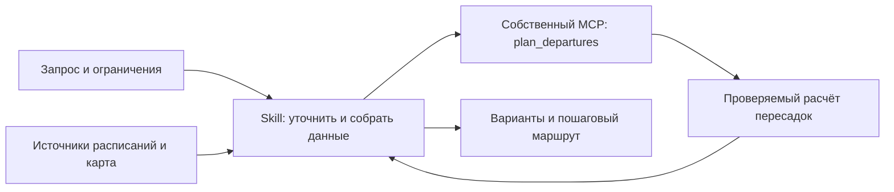

# Домашняя работа 4: планировщик загородных поездок

Статус: план подтверждён; реализация и проверка выполняются. Изменения по фактическим проверкам зафиксированы ниже.

## Цель и границы

Сделать собственный skill `transit-trip-planner`, который помогает выбрать,
во сколько выйти из дома, чтобы доехать общественным транспортом с удобными
пересадками. Итог проекта — вся готовая домашняя работа 4, включая собственный
MCP, демонстрацию среды, проверку результата и личную рефлексию.

Контрольный маршрут пользователя: **Альпийский переулок, Санкт-Петербург →
Малый Лужский каньон у Плоского**. Перед настоящим расчётом уточняем дату,
окно выхода и дом либо общественный ориентир на переулке. Адрес не сохраняем
в публикуемых доказательствах без необходимости. Для конца маршрута проверяем
доступ к тропе: координаты природного объекта сами по себе не являются входом.

Первая версия рассчитывает поездку в одну сторону по Санкт-Петербургу и
Ленинградской области: подход и городской транспорт, затем до трёх участков
с точным расписанием, затем пеший путь до цели. Ограничение на число участков
сообщается пользователю. Контрольный маршрут — пример, не зашитый в алгоритм.
Возвращение, поиск мест отдыха, покупка билетов и сопровождение в реальном
времени в эту домашку не входят.

## Что получает пользователь

1. До пяти различных подходящих вариантов: время выхода, прибытие, полное
   время в пути, ожидание, пересадки и запас времени.
2. Для каждого — последовательность действий с остановками, рейсами,
   временем перехода, отправления и прибытия.
3. Ссылки на источники, дату расписания, время проверки и явные оценки там,
   где точного расписания нет.
4. Краткое объяснение порядка вариантов и важных ограничений покрытия.

Показываем лучшие варианты **среди проверенных цепочек маршрута**. Не обещаем
глобальный оптимум по всей транспортной сети. Если подходящих вариантов два,
выдаём два. При отсутствующих данных сообщаем, чего не хватает.

## Как устроено решение

Skill отвечает за смысл: распознаёт запрос, выбирает разумные цепочки,
собирает расписания, различает подтверждённые данные и оценки, вызывает
инструмент и объясняет результат. Python-модуль отвечает за арифметику и
отбор. MCP делает этот модуль доступным агенту как один полезный инструмент.
Получение расписаний — отдельный адаптер; арифметика не дублируется в skill.

Основной кандидат источника — бесплатный API Яндекс Расписаний. Перед его
подключением проверяем доступность ключа, действующие условия применения
для выбранного учебного формата и реальное покрытие нужных рейсов. Платные
сервисы не подключаем. Если API недоступен или покрытие неполное, skill может
собрать данные из доступного официального расписания перевозчика/муниципалитета
в тот же входной формат, со ссылкой и датой проверки. Такой источник помечаем
как ручное извлечение, а степень автоматизации честно указываем в отчёте.

Городской участок и пешие переходы берём из проверенного маршрута по карте
или заданной пользователем длительности. Это оценки, а не гарантированное
время. Если городской участок сам имеет редкие отправления, его нельзя
сворачивать в фиксированную длительность: нужен ещё один участок расписания.

## Контракт расчёта

`plan_departures(request: PlanRequest) -> PlanResult` — чистая функция;
одноимённый MCP tool вызывает её. Модели и валидация живут в `models.py`.

| Вход | Содержание |
|---|---|
| `departure_window` | Два ISO 8601 момента с часовым поясом, включительно |
| `timezone` | В первой версии `Europe/Moscow` |
| `max_options` | Целое число от 1 до 5, по умолчанию 5 |
| `boarding_buffer_minutes` | Неотрицательный запас перед первым рейсом; предложение по умолчанию 10 минут, доступно изменение |
| `sources` | ID, URL, `checked_at`, применимые даты, `mode` (`live`, `manual`, `fixture`), состояние проверки |
| `chains` | Кандидатные цепочки, подготовленные skill из найденных источников |

У каждой цепочки: ID, подписанные начальная и конечная точки, длительность
и описание подхода/городского участка и последнего пешего участка, ссылки
на их основания, массив `stages` и массив `transfers` между ними.

У этапа: ID остановок отправления и прибытия, список `trips`. У рейса: ID,
вид транспорта, номер/название, полные `departure` и `arrival`, `source_id`.
У перехода: обе остановки, `walk_minutes`, `buffer_minutes`. Число переходов
равно числу этапов минус один. Одинаковые названия остановок не заменяют ID.
Отрицательные длительности, неизвестные источники, некорректная хронология,
несогласованные остановки и время без часового пояса — ошибочный вход.

Расчёт перебирает комбинации рейсов в заданных цепочках:

- Следующее отправление должно быть не раньше предыдущего прибытия плюс
  переход и запас на пересадку. Равенство допустимо.
- Выход = первое отправление − подход/городской участок − запас на посадку.
- Прибытие к цели = последнее прибытие + заключительный пеший участок.
- Полное время = прибытие к цели − выход; оно включает все переходы и запасы.
- Ожидание = начальный запас + сумма промежутков между рейсами за вычетом
  переходов. Запас входит в ожидание и не прибавляется повторно.
- Выход должен попасть в заданное окно. Полные даты позволяют переходить
  через полночь без отрицательных длительностей.
- Сортировка: полное время, ожидание, число пересадок, время выхода,
  стабильный идентификатор. Для каждого времени выхода из одной начальной точки к одной цели
  оставляем лучший маршрут; худшие пути с тем же выходом не занимают слот.

`PlanResult` содержит `status`, `options`, `warnings`, использованные
источники и границы поиска. Каждый вариант содержит временную шкалу и
рассчитанные метрики; числа не пересчитываются языковой моделью.

- `ok`: есть варианты. При неполном покрытии — явное предупреждение, что
  отбор выполнен по доступным проверенным данным.
- `no_routes`: проверенные данные полны для заданных цепочек и окна, но
  подходящих комбинаций нет; это не утверждение об отсутствии транспорта
  вообще.
- `needs_data`: данных недостаточно, а подтверждённых вариантов нет.
- Невалидная структура/значение: диагностическая ошибка с полем и причиной;
  MCP возвращает ошибку вызова и продолжает работать.

Непроверенные, не относящиеся к дате или конфликтующие расписания не входят
в подтверждённые варианты. `checked_at` не гарантирует актуальность:
перед реальной выдачей skill проверяет применимость на дату поездки и
предупреждения об изменениях. Тестовые данные всегда помечаются `fixture`;
их результат нельзя представить как действующий маршрут.

## Проверяемые примеры

Все часы ниже — **вымышленные данные для тестов**, не расписание до Плоского.

| Случай | Ожидаемый результат |
|---|---|
| Первый рейс 10:40; подход 55 мин; запас 10 мин | Выход 09:35 |
| Прибытие 10:25; переход 5 мин; запас 10 мин; рейс 10:40 | Пересадка допустима |
| То же, но прибытие 10:26 | Пересадка не проходит |
| Рейс 23:50 → 00:20 следующего дня | Длительность 30 мин |
| Только два допустимых уникальных варианта | Ровно два результата |
| API не ответил или не выдал нужную остановку | Не выдавать это за отсутствие рейсов |

Реальная приёмка отдельно проверяет маршрут пользователя на согласованную
будущую дату. Ручной пересчёт лучшего варианта и проверка источников обязательны.

## Ограничения проекта

- Ветки никогда не содержат `codex`; рабочая ветка реализации — `homework_04`.
- Только бесплатные источники; ключи не попадают в чат, Git и доказательства.
- Python 3.12+; версия официального MCP SDK фиксируется после проверки совместимости.
- Язык объяснений и результата — русский; часовой пояс — `Europe/Moscow`.
- Notify Mini и результаты практик 1–3 сохраняются; новый проект расположен отдельно.
- Быстрые проверки не обращаются к расписаниям или LLM и укладываются в таймаут hook 30 секунд после установки зависимостей.
- До и после каждого этапа агент объясняет пользователю цель действия и проверенный результат.
- Личная рефлексия опирается на слова пользователя и наблюдавшиеся события.

## Источники, проверенные при планировании 07.10.2026

- [Задание и критерии домашки](../../../practices/practice_04/README.md).
- [Бесплатный API Яндекс Расписаний](https://yandex.ru/dev/rasp/raspapi),
  [доступ по ключу](https://yandex.ru/dev/rasp/doc/ru/concepts/access),
  [междугороднее покрытие](https://yandex.ru/dev/rasp/doc/ru/),
  [условия применения](https://yandex.ru/legal/timetable_api/ru/).
- [Запрос расписаний](https://yandex.ru/dev/rasp/doc/ru/reference/schedule-point-point):
  текущий домен `api.rasp.yandex-net.ru`; нужны дата и обработка страниц.
- [Администрация Толмачёвского поселения](https://gptolmachevo.ru/index.php/info/transport):
  источник для проверки отдельных заездов в Плоское; актуальность на будущую
  дату ещё не установлена.
- [Плоское в веб-расписании](https://rasp.yandex.ru/station/9821783/):
  кандидат остановки; покрытие API ещё не проверено.
- [Официальный поиск СЗППК](https://ticket.ppk-piter.ru/passenger/tiket/):
  контроль железнодорожных вариантов через Толмачёво/Лугу, не готовый маршрут.
- [Официальный Python SDK MCP](https://github.com/modelcontextprotocol/python-sdk).

Эти находки подтверждают возможность дальнейшей проверки источников,
но ещё не доказывают существование удобного маршрута на конкретную дату.

## Уточнения реализации по проверкам

- Источники: выбран предусмотренный импорт официальных данных, API-адаптер
  не подключён. CLI `validate` сохраняет происхождение и степень проверки.
- Неизвестное время подхода/выхода обозначается `null` и даёт `needs_data`.
- Независимый прогон выявил худший маршрут с тем же выходом; один лучший
  маршрут на время выхода лучше соответствует исходной задаче пользователя.
- Ожидание и число пересадок в метриках относятся к участкам с расписаниями;
  городской участок описывается отдельно и может включать ожидание метро.
