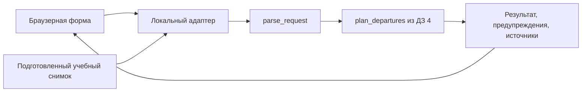

# ДЗ 5: браузерный расчёт времени выхода

Дата: 22.10.2026. Ветка: `practice_05`. База: `e828f5b1918cc7bb615ef1a85e769b5ec97f8466`.

**Статус:** BRIEF принят пользователем 22.10.2026: «да, берем такую форму. давай теперь этап 2 — установим и настроим Spec Kit». Приняты браузерная история, её объём и стек. Spec Kit 1.2.2 установлен и настроен: [FRAMEWORK](FRAMEWORK.md), общая feature-spec и constitution готовы. Это не две командные спецификации и не согласованный API-контракт. Код фичи не начат.

## Зачем и для кого

Планировщик уже умеет проверять подготовленные данные и считать подходящие времена выхода через CLI и MCP. Для повторного расчёта пользователь сейчас меняет JSON или обращается к агенту.

Новая история даёт локальный экран: изменить окно выхода, запас на посадку и число вариантов, нажать «Рассчитать» и прочитать результат. Расчёт выполняет существующее ядро ДЗ 4. Главная польза — повторный расчёт подготовленного маршрута без ручного изменения JSON и без LLM-запроса.

**User Story:** «Как пользователь планировщика поездок, я хочу задать окно выхода и запас на посадку в локальной форме для подготовленного маршрута, чтобы увидеть подходящие времена выхода и понять причины отсутствия результата».

## Связь с проектом и бэклогом

Источник проекта — [домашняя работа 4](../../practice_04/homework/README.md). Её код уже включён в текущую ветку через локальный `main`; копировать или переписывать ядро не требуется.

В [шаблоне первой практики](../../practice_01/product_management.md) нет заполненного бэклога этого планировщика. В [дизайне ДЗ 4](../../../docs/superpowers/specs/2026-10-07-homework4-trip-planner-design.md) описаны возможности, но нет исторически принятых US1/US2. Ниже нумерация вводится **сейчас, 22 октября**, как текущая декомпозиция проекта:

| История | Пользовательская возможность | Фактическое состояние |
| --- | --- | --- |
| US1 | Проверить и нормализовать подготовленный JSON с датами, ссылками и происхождением данных | Реализовано в `sources.py`, `models.py`, CLI `validate`; подтверждено baseline |
| US2 | Получить рассчитанные и ранжированные времена выхода по подготовленным цепочкам через CLI или MCP | Реализовано в `planner.py`, CLI `plan`, MCP; подтверждено baseline |
| US3 | Менять параметры подготовленной поездки и видеть результат в браузерной форме | Принятая новая история ДЗ 5; не реализована |

Так сопоставляем продолжение с «третьей User Story» из корневого README. Это не утверждение, что пронумерованный бэклог был согласован на предыдущих занятиях. US1 не включает автоматическое получение расписаний: источники подготавливает skill/агент отдельно.

## Минимальный объём истории

Один локальный экран и один подготовленный учебный маршрут:

- Видны начальная/конечная точки, дата снимка и пометка «Учебные данные».
- Поля: дата и время начала/конца окна по Москве, запас на посадку в минутах, число вариантов.
- Кнопка «Рассчитать», состояние ожидания, результат или понятное объяснение проблемы.
- У результата: выход, прибытие, полное время, ожидание, пересадки, участки пути, предупреждения и источники.
- Повторный расчёт использует изменённые параметры и то же настоящее ядро; данные снимка не переписываются.

Основной пример — [rare_connections.json](../../practice_04/homework/tests/fixtures/rare_connections.json), вымышленные данные на 14.10.2026. Дата по умолчанию берётся из снимка, не из сегодняшнего календаря. Сохранённый пример реальной поездки из ДЗ 4 остаётся историческим материалом, не обещанием актуального расписания.

**Не входит:** поиск между произвольными адресами, карты, геокодинг, живые расписания/API, автоматическая проверка свежести, каталог маршрутов, загрузка пользовательских файлов, база, авторизация, сохранение поездок и облачное размещение.

## Пять условий приёмки

Это требования к будущей фиче. Сейчас проверено только соответствующее поведение существующего ядра; браузерные проверки появятся после реализации.

| ID | Действие и наблюдаемый результат |
| --- | --- |
| AC1 | Учебный снимок, 14.10.2026 06:00–12:00, запас 10, лимит 5 → настоящий расчёт показывает 09:35–11:50, 135 минут, 10 минут ожидания, 0 пересадок; учебный характер данных виден |
| AC2 | Изменение запаса на 20 минут пересчитывает выход на 09:25 и полное время на 145 минут. Неверное окно/значение даёт понятную ошибку; после исправления доступен успешный повтор. Московское время не зависит от зоны компьютера |
| AC3 | Окно 14.10.2026 09:36–10:00 → `no_routes`: подходящих вариантов нет среди переданных подтверждённых цепочек. UI не заявляет отсутствие транспорта вообще |
| AC4 | Окно 15.10.2026 06:00–12:00 при том же снимке → `needs_data`: не хватает подтверждённых данных на эту дату. Даты рейсов и поля подтверждения источников не меняются |
| AC5 | Результат сохраняет предупреждения, источники и область поиска; `ok` с неполным покрытием не скрывается. Старые CLI/MCP-команды и регрессионные тесты продолжают работать |

Дополнительные границы: 09:35 включительно, равные начало/конец окна, лимит вариантов 1–5, запас 0–1440, неверные/пустые числа. Невалидный ввод — отдельная ошибка, а не новый `PlanResult.status`.

## Сохраняем существующее поведение

- `parse_request` проверяет вход, не исправляет даты или неизвестные значения догадками.
- `plan_departures` ранжирует только переданные цепочки; глобальный поиск по транспортной сети не появляется.
- Сохраняются статусы `ok`, `no_routes`, `needs_data`, а также `data_kind`, `warnings`, `sources`, `search_scope`.
- Неизвестная длительность (`null`) не становится нулём. Оценки пеших/городских участков остаются оценками.
- CLI `validate`/`plan`, коды завершения и MCP stdio с восстановлением после ошибочного вызова сохраняются.
- Штатные skills, hook, runner и материалы других практик остаются рабочими.

## Стек, расположение и граница компонентов

SDD-фреймворк **Spec Kit выбран пользователем** и настроен в версии 1.2.2; реальные команды и общие артефакты описаны в [FRAMEWORK](FRAMEWORK.md). Работа двух команд, реализация и итоговое сравнение с OpenSpec остаются следующими этапами.

Принятый стек истории:

- существующий Python 3.12+, uv и зависимости из [lock-файла ДЗ 4](../../practice_04/homework/uv.lock);
- браузерный HTML/CSS/JavaScript без UI-фреймворка;
- тонкий локальный Python HTTP-адаптер к ядру, доступный на loopback;
- прежние unittest/Ruff плюс контрактные и браузерные проверки новой части; конкретный E2E-инструмент выбрать при техническом планировании.

Новая часть и материалы — `practices/practice_05/homework/`; предлагаемое место UI/адаптера — `web/`, проверок — `tests/`. Ядро остаётся в `practices/practice_04/homework/trip_planner/`. Способ импорта и точные команды нового сервера определяются в реализации после согласования контракта.



UI не рассчитывает маршрут в JavaScript. Адаптер копирует подготовленный снимок, меняет только разрешённые параметры формы, вызывает ядро и возвращает результат. Произвольные пути к серверным файлам не принимаются.

Конкретные HTTP-операции, схемы тела запроса/ошибки, коды ответов, ожидание и поведение повторного нажатия определят две команды на этапах 3–4. Здесь готовится общий контекст; спорные детали API заранее не навязываются.

## Фактический baseline первого этапа

Прогоны выполнены 22.10.2026 из `/Users/pip/ITMOv2`, на `practice_05`, HEAD `e828f5b1918cc7bb615ef1a85e769b5ec97f8466`.

| Команда | Фактический результат |
| --- | --- |
| `sh scripts/check.sh` | Exit 0: Ruff check/format, 8 Notify Mini, 28 ДЗ 4 включая настоящий stdio MCP, 6 hook |
| `make test` | Exit 0: материалы практик 1–2, 8 Notify Mini, 28 ДЗ 4/Ruff, 16 практики 6 |
| `git diff --check` | Exit 0: проверка отслеживаемого diff на момент baseline |
| CLI `validate` на fixture | Exit 0: нормализованный JSON |
| CLI `plan` на fixture | Exit 0: `ok`, выход 09:35 |

Всего **58 различных существующих тестов**; повторный запуск некоторых наборов второй командой не увеличивает это число. Все проверки прошли. Это baseline ДЗ 4 и окружения, не тесты новой формы.

Полные команды, stdout/stderr, exit codes и исходный stdin сценарного прогона: [baseline.txt](evidence/baseline.txt). Структурированные факты: [baseline-scenarios.json](evidence/baseline-scenarios.json).

Отдельно восемью проверками существующего ядра подтверждены: обычный результат, пересчёт запаса, `no_routes`, `needs_data`, включённая граница, ошибка окна, неверный лимит вариантов и `ok` с неполным покрытием. Исходные входные данные и fixture не изменялись. Эти проверки не считаются браузерным E2E.

Для воспроизведения из корня:

```sh
sh scripts/check.sh
make test
git diff --check
uv run --directory practices/practice_04/homework --locked --offline \
  python -m trip_planner.cli validate --input tests/fixtures/rare_connections.json
uv run --directory practices/practice_04/homework --locked --offline \
  python -m trip_planner.cli plan --input tests/fixtures/rare_connections.json
```

Если зависимости отсутствуют, сначала `make -C practices/practice_04/homework install`. Во время этого этапа установка не потребовалась.

## Принятое решение первого этапа

Предмет просмотра: новая US3 — браузерная форма над готовым ядром; один учебный снимок; пять AC; HTML/CSS/JS и тонкий Python-адаптер; сохранение MCP/CLI и источников без автоматического обновления.

Пользователь принял этот объём 22 октября и поручил этап 2: установку и настройку Spec Kit. Это не подменяет будущую отдельную приёмку двух спецификаций и общего контракта перед кодом.

## Актуализация29.10.2026

Первоначальный объём выше сохраняется как история принятого22 октября BRIEF. По поручению «добавь это» основной сценарий заменён реальным датированным снимком30.10.2026; fixture остаётся режимом контроля прежних AC. Объём не включает каталог, свободный поиск и live API. Текущие дополнительные критерии RTE-001–005 и источники — REAL_ROUTE_CHANGE.md; CONTRACT/after/constitution1.1 обновлены до изменения кода.
