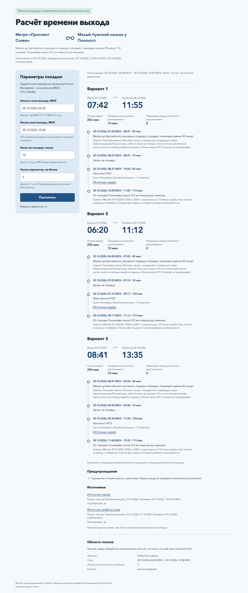

# ДЗ 5: браузерный расчёт времени выхода

Локальная форма продолжает планировщик ДЗ 4: пользователь меняет окно выхода,
запас на посадку и число вариантов, а существующее Python-ядро считает поездку.
Ветка — `practice_05`. Основное демо — реальный маршрут **метро «Проспект Славы» →
Малый Лужский каньон у Плоского** через Балтийский вокзал и Толмачёво.
Расписание СЗППК сохранено на **30 октября 2026**, проверено 29 октября.
Подход к вокзалу и пеший участок — явно обозначенные оценки. Это датированный
снимок: приложение не обновляет расписание автоматически.

## Запуск

Нужны Python 3.12+ и uv. Из корня репозитория:

```sh
# Один раз, если окружение ДЗ 4 ещё не установлено:
make -C practices/practice_04/homework install

# Локальный сервер; остановка Ctrl+C:
make -C practices/practice_05/homework serve
```

Открыть [форму](http://127.0.0.1:8765). Другой порт:
`make -C practices/practice_05/homework serve PORT=8766`.
После установки зависимостей запуск и расчёт выполняются offline,
без LLM и аккаунта. Сервер слушает только `127.0.0.1`.

Время вводится явно как `ДД.ММ.ГГГГ ЧЧ:ММ`, например `30.10.2026 06:00`.
Это всегда Москва и 24-часовой формат независимо от зоны и языка компьютера.
Начало/конец включены; конец не переносится автоматически на завтра.
Запас — целое 0–1440, число вариантов — целое 1–5.

## Что проверить на экране

| Действие | Результат |
| --- | --- |
| Исходные значения: 30 октября, 06:00–10:00, запас 10, лимит 5 | Три варианта; лучший: выход 07:42, прибытие 11:55, 253 минуты |
| Запас 20 | Выход 07:32, 263 минуты, прибытие 11:55 |
| 30 октября 08:00–08:10, запас 10 | Нет подходящих вариантов среди переданных подтверждённых цепочек (`no_routes`) |
| 31 октября 06:00–10:00 | Не хватает подтверждённых данных (`needs_data`), рейсы не перенесены |
| 30 октября 22:40–23:00, запас 10 | Рейс 6141: 23:45 → 31 октября 01:48; прибытие к цели 03:43, даты видны в этапах |
| Конец раньше начала, пустота или дробный запас | Понятная ошибка; исправление позволяет повтор без перезапуска |

Подход к вокзалу — **45 минут** (40 на метро с ожиданиями/переходом и 5 на вокзал),
отдельно добавляется выбранный запас. После электрички — **около 9,2 км пешком**,
оценка 110 минут по BRouter и 5 минут выхода с платформы, всего **115 минут**.
Путь к цели, оценки, даты проверки и ссылки видны на экране. Источники и все
11 рейсов — [REAL_ROUTE_SOURCES](REAL_ROUTE_SOURCES.md). Перед поездкой
расписание и условия пешего пути требуют актуальной проверки.

Можно редактировать поля во время ожидания. Старый итог исчезает,
ответ предыдущей редакции не заменяет актуальный. Через 10 секунд ожидания
появится ошибка и возможность ручного повтора; автоматических повторов нет.

## Архитектура и границы

`web/server.py` читает один фиксированный датированный снимок при старте. Каждый POST
получает глубокую копию, меняет только четыре значения формы и вызывает
существующие `parse_request` → `plan_departures` ДЗ 4. Ядро, lock и схемы
CLI/MCP сохранены; браузер не считает маршруты. Файлы UI отдаются только
по фиксированным URL; HTTP не принимает пути к файлам или shell-команды.

`GET /api/trip` возвращает метаданные/defaults, `POST /api/plan` — полный
`PlanResult`. Три статуса расчёта отделены от ошибок ввода и связи.
`ok` возможен с неполным покрытием. Предупреждения, источники, оценки,
дробные длительности и область поиска сохраняются. Подробности —
[принятый CONTRACT](CONTRACT.md).

Нет поиска адресов, встроенной карты, живого обновления расписаний, загрузки
файлов, БД, авторизации, истории поездок и облака. Ранжирование охватывает
только переданные цепочки. Применимость пешей карты на 31 октября не означает
наличие расписания электричек на эту дату.

## Контрольный учебный пример

Для исходных AC1–AC5 остановить основной сервер и запустить
`make -C practices/practice_05/homework serve-fixture` (фиксированный `--fixture`).
Экран явно помечает вымышленные данные. 14 октября 06:00–12:00/10 →
09:35–11:50/135 минут; запас20 →09:25/145; окно09:36–10:00 →no_routes;
15 октября →needs_data; равные границы09:35 включают вариант.
В HTTP и форме нет выбора файла или датасета.

## Проверки

```sh
make step5
sh scripts/check.sh
make test
git diff --check
```

`step5`: Ruff, 21 unittest с настоящим HTTP/ядром, 17 браузерных сценариев.
В проекте 96 уникальных тестов: check.sh выполняет 80, make test — 90;
пересекающиеся наборы не складываются повторно.
`check.sh` включает прежние проверки и hook; `make test` также проверяет
остальные практики. Проверки не пишут evidence, если отдельно не задан
`HW5_SCREENSHOTS_DIR`. Тестовые серверы используют свободный loopback-порт
и завершаются по окончании прогона.

Для браузерных тестов нужны Node, Playwright и Chrome/Chromium. В текущем
окружении найден Playwright 1.62.1 из bundled runtime и системный Chrome;
новые зависимости ядра не устанавливались. На другой машине можно выполнить:

```sh
npm install --prefix /tmp/itmo5-browser --no-save --package-lock=false playwright@1.62.1
/tmp/itmo5-browser/node_modules/.bin/playwright install chromium
PLAYWRIGHT_MODULE_PATH=/tmp/itmo5-browser/node_modules/playwright make step5
```

Для произвольного установленного браузера задать `BROWSER_EXECUTABLE` полным
путём. Для другого Node можно передать `NODE=/полный/путь/node` как аргумент
make. Приложение само по себе не требует Node/Playwright/Chrome на сервере.

## Материалы сдачи

- [Пошаговая инструкция для защиты](DEFENSE_GUIDE.md): что говорить, какие файлы открывать и что проверить в демо.
- [BRIEF](BRIEF.md), [настройка Spec Kit](FRAMEWORK.md),
  [общая feature-spec и штатный plan/tasks](../../../specs/001-trip-planner-form/).
- Две независимые [UI before](specs/ui.before.md)/[logic before](specs/logic.before.md),
  согласованные [UI after](specs/ui.after.md)/[logic after](specs/logic.after.md),
  [CONTRACT](CONTRACT.md), [решения и точная приёмка человека](AGREEMENT.md).
- [Технический план](IMPLEMENTATION_PLAN.md), [отчёт и сравнение SDD](REPORT.md),
  [короткое демо](evidence/demo.md), RED/GREEN и проверки в `evidence/`.


