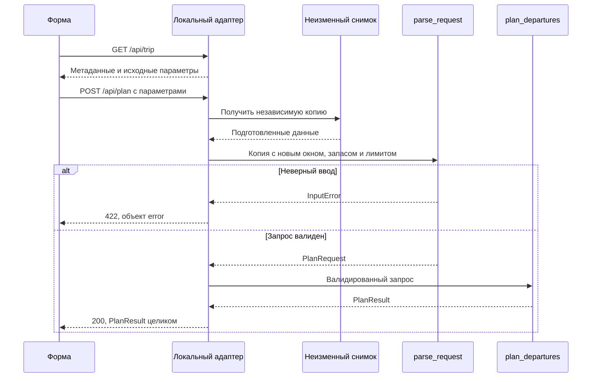

# Команда логики: исходная спецификация формы расчёта поездки

**Версия:** before, 1.0. **Дата:** 22.10.2026. **Ветка:** `practice_05`.

**Статус:** независимый ролевой черновик этапа 3, до согласования с UI и человеком.
Общая feature-spec остаётся в `specs/001-trip-planner-form`. Этот документ
не является новым feature-spec, общим контрактом или разрешением писать код.

**Задача:** дать пользователю повторный расчёт одного подготовленного учебного
маршрута через локальную форму: начало и конец окна выхода по Москве,
запас на посадку и число вариантов. Расчёт остаётся в Python-ядре ДЗ 4.

Использованы обязательные разделы и критерии качества Spec Kit. По поручению
координатора workflow создания фичи, изменение общего checklist/constitution,
планирование и реализация не выполняются. HTTP-операции и новые схемы ниже —
первоначальная позиция команды логики. Исходная спецификация UI не читалась;
межкомандные расхождения пока не установлены. После согласования изменения
следует записать в after, сохранив этот before.

## Пользовательские сценарии и приёмка

### US3 — пересчитать подготовленную поездку (приоритет P1)

Как пользователь планировщика, я хочу изменить окно выхода, запас на посадку
и число вариантов в форме, чтобы получить расчёт без редактирования JSON
и понять причину отсутствия результата.

**Почему P1:** это одна принятая история ДЗ 5. Валидация данных и расчёт через
CLI/MCP уже существуют; новая часть открывает их результат пользователю формы.

**Независимая проверка:** после реализации открыть локальную форму с одним
учебным снимком, выполнить обычный расчёт и повторить его с изменёнными
параметрами, ошибкой и неподдерживаемой датой. Сверить ответ с ядром,
не обращаясь к LLM и живым расписаниям. Контрактная проверка адаптера нужна,
но сама по себе не заменяет будущую сквозную проверку через браузер.

Все времена ниже относятся к `Europe/Moscow`. Это ожидаемая приёмка будущей
формы и адаптера; выполненный baseline доказывает только поведение ядра.

| Сценарий | Дано / когда | Тогда | Связь с BRIEF |
| --- | --- | --- | --- |
| LOG-AS-001 | Исходный fixture, 14.10.2026 06:00–12:00, запас 10, лимит 5; пользователь запускает расчёт | `ok`, один вариант 09:35–11:50, 135 минут, ожидание 10, пересадок 0; `data_kind=fixture`, учебная пометка и источник доступны | AC1, AC5 |
| LOG-AS-002 | После первого успеха запас меняется на 20 при том же окне | Новый результат: выход 09:25, прибытие 11:50, 145 минут, ожидание 20; снимок прежний | AC2 |
| LOG-AS-003 | Конец окна раньше начала либо лимит 6, пустое/неверное число; затем исправление на исходные параметры | Ошибка ввода отдельно от `PlanResult`; следующий корректный вызов даёт результат LOG-AS-001 без перезапуска | AC2 |
| LOG-AS-004 | Исходный запас 10; окно 14.10.2026 09:36–10:00 | `no_routes`, `options=[]`, `search_scope.complete=true`; вариантов нет среди переданных проверенных цепочек | AC3, AC5 |
| LOG-AS-005 | Тот же снимок; окно 15.10.2026 06:00–12:00 | `needs_data`, `options=[]`, `search_scope.complete=false`; предупреждение о покрытии дат, рейс остаётся 14 октября | AC4, AC5 |
| LOG-AS-006 | Запас 10; окно 14.10.2026 09:35–09:35 | `ok`, выход 09:35 включён; равные границы допустимы | AC2, AC3 |
| LOG-AS-007 | В отдельной тестовой копии исходного запроса изменено только `coverage` на `partial` | `ok` с тем же найденным вариантом, `search_scope.complete=false`, предупреждение о неполном покрытии; это не новая возможность формы | AC5 |
| LOG-AS-008 | Вызовы успех → неверный ввод → `needs_data` → исходный успех | Исходные данные, рейсы и источники неизменны; последний ответ равен первому по содержанию | AC2, AC4, AC5 |
| LOG-AS-009 | Те же параметры формы в окружениях браузера с разными часовыми поясами | На вход ядра попадают одинаковые московские моменты; результат совпадает с LOG-AS-001 | AC2 |
| LOG-AS-010 | Ответ потерян из-за сбоя связи; пользователь повторяет тот же корректный запрос | Повтор не имеет побочных эффектов, возвращает тот же расчёт; форма не выдаёт старый ответ за результат новых параметров | AC2, AC5 |

### Пограничные случаи

- Окно ограничивает **время выхода из начальной точки**, не время отправления
  автобуса и не прибытие к цели. Прибытие после конца окна допустимо.
- Обе границы включены. Перевёрнутое окно не означает перенос конца на завтра.
- Лимит — целое 1–5; запас — целое 0–1440. Ноль допустим для запаса,
  но не для лимита. Единственный вариант не дополняется до пяти.
- Пустое поле, `null`, логическое значение, строка с числом, дробное число
  и выход за границы не исправляются подстановкой значения по умолчанию.
  Поля HTML сначала являются строками; UI должен проверить их целиком и
  отправить целые JSON-числа, без усечения вроде `parseInt("1.5")`.
- Дата вне подтверждённого покрытия — корректный пользовательский параметр;
  это может дать `needs_data`, а не ошибку синтаксиса даты.
- Неизвестные `access.minutes`/`egress.minutes` не равны нулю. В отдельной
  тестовой копии такого запроса ядро пропускает цепочку и сохраняет причину
  неполноты. Редактирование этих величин пользователем не входит в форму.
- Целые входные параметры не гарантируют целых длительностей результата:
  расписанные моменты могут содержать секунды. Нельзя терять дробную часть
  `total_minutes`, `waiting_minutes`, `timeline[].minutes`.
- При `ok` с неполнотой найденный вариант сохраняется. Полнота подтверждения
  и наличие подходящего варианта — разные свойства результата.

## Требования

### Функциональные требования

Здесь «ДОЛЖЕН» задаёт проверяемое требование к будущей реализации. Ссылки AC
обозначают условия [BRIEF](../BRIEF.md); новые транспортные детали остаются
предложением до этапа согласования.

| ID | Требование | AC |
| --- | --- | --- |
| LOG-FR-001 | Адаптер ДОЛЖЕН предоставлять один фиксированный учебный маршрут, его начало/конец, применимую дату снимка, часовой пояс, исходные параметры и учебное происхождение данных. Дата по умолчанию — 14.10.2026 из снимка, не текущая дата компьютера | AC1 |
| LOG-FR-002 | Пользовательский запрос ДОЛЖЕН изменять только `departure_window.start`, `departure_window.end`, `boarding_buffer_minutes`, `max_options`. Все четыре значения обязательны в предлагаемом запросе | AC1, AC2 |
| LOG-FR-003 | Адаптер ДОЛЖЕН отклонять дополнительные поля, включая пользовательские `chains`, `sources`, путь к файлу, произвольный маршрут, команду или URL источника. Подготовленные данные выбирает приложение | AC4, AC5 |
| LOG-FR-004 | Каждый допустимый расчёт ДОЛЖЕН проходить через существующий `parse_request` и затем `plan_departures` из ДЗ 4. Копирование арифметики в адаптер или UI и запуск CLI через shell при обработке запроса запрещены | AC1–AC5 |
| LOG-FR-005 | Запас и лимит ДОЛЖНЫ проверяться как строгие целые с границами 0–1440 и 1–5. Строки, `true`/`false`, `null`, дроби и JSON-число `5.0` не принимаются вместо строгого целого | AC2 |
| LOG-FR-006 | Время ДОЛЖНО трактоваться по Москве независимо от зоны ОС/браузера. Вход без явной привязки к Москве и неверная календарная дата отклоняются; сравнение границ выполняется без автоматического переноса даты | AC2, AC4 |
| LOG-FR-007 | Равные начало и конец ДОЛЖНЫ допускаться, а попадание выхода на любую границу ДОЛЖНО сохранять включительность существующего ядра | AC2, AC3 |
| LOG-FR-008 | Для каждого вызова ДОЛЖНА создаваться независимая полная копия исходного запроса с заменой только разрешённых параметров. Исходный файл и вложенные структуры снимка остаются неизменными при любом исходе | AC2, AC4, AC5 |
| LOG-FR-009 | Смена окна и повторный вызов НЕ ДОЛЖНЫ сдвигать рейсы, менять `valid_dates`, `checked_at`, `verified`, `mode`, `coverage`, оценки подхода/выхода или связи источников | AC4, AC5 |
| LOG-FR-010 | Адаптер ДОЛЖЕН сохранять рассчитанные ядром порядок и количество вариантов, устранение дублей и временную шкалу; повторно ранжировать, пересчитывать или дополнять варианты запрещено | AC1, AC2, AC3, AC5 |
| LOG-FR-011 | Успешно выполненный расчёт ДОЛЖЕН возвращать ровно один из существующих статусов `ok`, `no_routes`, `needs_data`, сохраняя `search_scope.complete`; `ok` при `complete=false` допускается | AC3, AC4, AC5 |
| LOG-FR-012 | В ответе ДОЛЖНЫ сохраняться все поля `PlanResult`, в том числе `options`, `warnings`, `sources`, `data_kind`, `search_scope`, признаки `estimated`/`basis` и ссылки `source_id` временной шкалы. Неполнота и учебный характер данных не скрываются | AC1, AC5 |
| LOG-FR-013 | Числовые длительности ДОЛЖНЫ передаваться без усечения или округления в адаптере. Форматирование UI не должно менять исходное число или выдавать оценку за точное расписание | AC1, AC5 |
| LOG-FR-014 | Неизвестная длительность ДОЛЖНА оставаться неизвестной; нельзя подменять её нулём, заменять `needs_data` на `no_routes` либо удалять предупреждения ради выдачи варианта | AC4, AC5 |
| LOG-FR-015 | Ошибки JSON/полей, ошибки доступности приложения и вычислительные ответы ДОЛЖНЫ различаться. Невалидный ввод не создаёт четвёртый `PlanResult.status`, не возвращает частичный или предыдущий результат | AC2 |
| LOG-FR-016 | После ошибки ввода или сбоя отдельного вызова адаптер ДОЛЖЕН оставаться пригодным для следующего корректного запроса; значения ошибочного запроса не сохраняются как новые значения снимка | AC2, AC5 |
| LOG-FR-017 | Повтор одинакового запроса ДОЛЖЕН давать тот же результат по содержанию без изменения данных, записи поездки или обновления отметки проверки источника | AC2, AC4, AC5 |
| LOG-FR-018 | UI и адаптер ДОЛЖНЫ обеспечивать связь ответа с отправленными параметрами: поздний ответ предыдущего запроса не становится новым результатом. Конкретный механизм согласуется с UI | AC2 |
| LOG-FR-019 | HTTP-адаптер ДОЛЖЕН слушать loopback; основной сценарий ДОЛЖЕН работать без внешней сети, LLM, живого расписания, учётной записи и загрузки пользовательских файлов | AC1, AC4, AC5 |
| LOG-FR-020 | Действующие CLI `validate`/`plan`, их коды выхода и MCP stdio ДОЛЖНЫ сохранить прежнее поведение. Их нельзя переименовывать или заменять HTTP-обёрткой | AC5 |

### Сущности и данные

| Сущность | Данные и смысл | Владение |
| --- | --- | --- |
| Учебный снимок | Один исходный `PlanRequest`: `timezone`, исходное окно и настройки, цепочки, источники, рейсы, оценки | Только приложение; неизменная основа всех вызовов |
| Параметры формы | Два момента окна, запас и лимит; не содержат маршруты/источники | UI передаёт, адаптер проверяет |
| `Source` | `id`, `url`, `checked_at`, `valid_dates`, `mode`, `verified` | Снимок; из ядра передаётся целиком |
| `Chain` | Идентификатор, начало/конец, `coverage`, подход/выход, расписанные этапы и переходы | Снимок; UI не редактирует |
| Вариант | `chain_id`, начало/конец, `leave_at`, `arrive_at`, `total_minutes`, `waiting_minutes`, `transfer_count`, `timeline` | Вычисляет только ядро |
| Результат | Три статуса, варианты, предупреждения, источники, происхождение и область поиска | Возвращает ядро; адаптер сериализует |
| Ошибка адаптера | Машинный код, понятное сообщение, необязательное поле ввода | Новое предложение; не `PlanResult` |

Для fixture: маршрут `training-route`, «Учебная точка А» → «Учебная точка Б»;
подход 55 минут и выход 10 минут — вымышленные оценки. Учебный автобус
отправляется 14.10.2026 в 10:40 и прибывает в 11:40. Источник `synthetic`
имеет `mode=fixture`, `valid_dates=["2026-10-14"]`,
`checked_at=2026-10-07T12:00:00+03:00`, `verified=true`.

Дата применимости 14 октября и дата проверки 7 октября — разные поля.
`verified=true` внутри fixture не превращает учебный автобус в реальный.
Наличие только источников без `mode=fixture` даёт `data_kind=real` по коду,
но само по себе не обещает актуальность расписания на сегодня.

## Измеримые исходы

- **LOG-SC-001:** исходный расчёт даёт один вариант 09:35–11:50, 135 минут;
  изменение запаса на 20 даёт 09:25 и 145 минут без изменения прибытия.
- **LOG-SC-002:** два отрицательных контрольных окна дают разные объяснения:
  отсутствие подходящего варианта 14 октября и нехватка данных 15 октября.
- **LOG-SC-003:** после неверного ввода пользователь исправляет параметры
  и получает исходный успех без перезапуска приложения и восстановления файла.
- **LOG-SC-004:** для результата с неполным покрытием сохраняются найденный
  вариант, предупреждение и признак неполноты; сохранены все источники
  и область поиска, доступные для чтения пользователем.
- **LOG-SC-005:** последовательность LOG-AS-008 завершается исходным успехом;
  снимок и его вложенные данные совпадают с исходными до и после каждого шага.
- **LOG-SC-006:** смена часового пояса компьютера не меняет результат одного
  московского ввода; все пять AC имеют будущую наблюдаемую проверку через форму.

Это критерии будущей приёмки. В этом этапе новые тесты, UI, HTTP и интеграция
не реализованы и не проверены; регрессию и итоговые проверки ведёт координатор.

## Допущения и границы

- Один локальный пользователь, один заранее выбранный fixture. Маршрут и дата
  по умолчанию не выбираются по текущему календарю или геолокации.
- Принятый стек: существующий Python 3.12+ с lock-файлом ДЗ 4 и браузерные
  HTML/CSS/JavaScript без UI-фреймворка; тонкий локальный HTTP-адаптер.
- Новая часть ДЗ 5 не должна требовать обновления зависимостей ядра.
- Входные поля окна имеют минутную точность в форме; адаптер не уменьшает
  точность дат/длительностей, уже присутствующих в подготовленных данных.
- Нет адресного поиска, карт, каталога маршрутов, живых API, загрузки файлов,
  БД, авторизации, хранения поездок, облака и фонового обновления снимка.
- Статический HTTP-экран и адаптер предполагаются на одном локальном origin.
  Порт и команда запуска относятся к последующему техническому планированию.
- Перед кодом нужны общий контракт, обе after-спецификации и решение человека.
  Принятие BRIEF или создание этого документа не заменяет такой приёмки.

## Подтверждённые интерфейсы и поведение ядра

Эта часть описывает прочитанный код, а не новый API.

| Интерфейс | Существующая сигнатура и поведение |
| --- | --- |
| `models.parse_request(payload: dict) -> PlanRequest` | Вызывает `PlanRequest.model_validate`, превращает `ValidationError` в `InputError` с текстовыми путями полей; не предоставляет отдельный структурированный массив ошибок |
| `models.PlanRequest` | `departure_window`, `timezone="Europe/Moscow"`, `max_options=5`, `boarding_buffer_minutes=10`, `sources`, `chains`; дополнительные поля запрещены во вложенных моделях |
| `planner.plan_departures(request: PlanRequest) -> PlanResult` | Считает варианты и возвращает обычный словарь; не получает расписания из сети |
| `models.PlanResult` | `TypedDict`: `status`, `options`, `warnings`, `sources`, `data_kind`, `search_scope`; это описание результата, не новый Pydantic-вход |
| `sources.load_request(path: Path \| str) -> PlanRequest` | Читает файл, отклоняет повторяющиеся JSON-ключи и вызывает `parse_request`; путь нужен существующей точке загрузки, не становится параметром HTTP |
| `cli.main(argv=None)` | Команды `validate`/`plan`, файловые `--input`/`--output`; возврат 0 при выполнении, 2 при обработанных ошибках входа/файла |
| `server.plan_departures(request: PlanRequest) -> PlanResult` | Собственный MCP-инструмент вызывает то же ядро; сервер запускается через `mcp.run(transport="stdio")` |

`Moment` в существующей модели — aware datetime, нормализованный в
`Europe/Moscow`. Ядро принимает момент с явным другим offset и приводит его
к Москве; это шире предлагаемого ниже браузерного входа. Наивная дата-время
без зоны не является допустимым `Moment`.

`Minutes` использует `StrictInt`, диапазон 0–1440; `max_options` — `StrictInt`
1–5. Модель проверяет порядок окна, хронологию рейсов, уникальность ID,
ссылки источников и связность переходов. Разрешено до 20 цепочек, до трёх
расписанных этапов в цепочке; предусмотрен предел 50 000 шагов перебора.
Лимит результатов не заменяет этот предел сложности. Адаптер не ослабляет
валидацию даже для фиксированного снимка.

### Алгоритм, который сохраняется в ядре

1. Для каждой цепочки неизвестное время подхода/выхода означает пропуск
   цепочки и неполноту, а `coverage != complete` отмечает неполноту, но само
   по себе не запрещает находить варианты.
2. `_coverage_gaps` проверяет подтверждённые даты возможной посадки: окно
   выхода сдвигается на подход и запас; последующие этапы учитывают прибытия
   предыдущих рейсов и переходы. Простого сравнения даты окна с одной
   `valid_dates` недостаточно. Пустой этап может иметь `stage.source_ids`
   для подтверждения покрытия даже без рейсов.
3. В перебор попадают рейсы с подтверждённым источником и датой отправления
   в его `valid_dates`. Подтверждения подхода/выхода, если переданы их
   `source_ids`, проверяются на соответствующие даты выхода/прибытия.
4. Выход = отправление первого рейса − подход − запас на посадку.
   Он должен попадать в замкнутое окно. Следующий рейс достижим, если его
   отправление не раньше предыдущего прибытия + ходьба + запас пересадки.
   Прибытие к цели = прибытие последнего рейса + выход до цели.
5. Полное время = прибытие к цели − выход из начальной точки. Ожидание
   включает посадочный запас и ожидания между расписанными этапами после
   ходьбы. Число пересадок = число расписанных этапов − 1; метро/ожидания
   внутри оценочного подхода не становятся дополнительными пересадками.
6. Сортировка: полное время, ожидание, число пересадок, время выхода,
   ID цепочки и ID рейсов. Для одинаковых начала/цели/времени выхода
   остаётся лучший путь; возвращается не более `max_options` вариантов.
7. Ядро формирует предупреждения без дублей, все источники и `search_scope`.
   Адаптер не повторяет этот алгоритм и не объявляет глобальный оптимум сети.

| Найдены варианты | Покрытие по результату ядра | `status` | Значение |
| --- | --- | --- | --- |
| Да | `complete=true` | `ok` | Есть подходящие варианты в переданном наборе |
| Да | `complete=false` | `ok` | Варианты есть, но подтверждения неполны; предупреждения обязательны |
| Нет | `complete=true` | `no_routes` | В подтверждённом переданном наборе подходящих вариантов нет |
| Нет | `complete=false` | `needs_data` | Для вывода не хватает подтверждённых данных |

`search_scope.complete` — отдельное поле, а не дополнительный статус.
`warnings`, `sources`, `data_kind` и `search_scope` сохраняются и при пустом
списке вариантов. Ошибка `InputError` не является строкой этой таблицы.

## Предложение: преобразование формы и операции адаптера

Всё в этом разделе — новое предложение для согласования, а не существующие
сигнатуры ДЗ 4. Существующий Python API и его схема не меняются.

### Операции локального HTTP

| Операция | Предлагаемый результат | Ошибки |
| --- | --- | --- |
| `GET /api/trip` | 200, метаданные единственного маршрута, учебная пометка, даты применимости, источники, московские defaults и границы полей | 500 при недоступности подготовленного снимка |
| `POST /api/plan` | 200, исходный `PlanResult` без внешней оболочки для всех трёх вычислительных статусов | 400 — нарушенный JSON/повтор ключа; 415 — неподдерживаемый Content-Type; 422 — неверные параметры; 500 — внутренняя ошибка |

Для неизвестного URL предлагается 404, для неподдерживаемого метода — 405.
Это служебные ошибки адаптера, а не исходы поиска. HTTP 200 при `needs_data`
и `no_routes` означает выполненный расчёт, а не наличие найденного маршрута.

`GET /api/trip` предлагается возвращать с ключами `route` (`id`, `origin`,
`destination`), `timezone`, `data_kind`, `schedule_dates`, `sources`,
`defaults` и `limits`. В `defaults` — ровно форма тела `POST /api/plan`;
в `limits` — пары `min`/`max` для запаса и числа вариантов. У этого fixture
`schedule_dates=["2026-10-14"]`; это применимость расписания, не дата его
проверки. Пользователю не требуется путь к JSON или редактирование источников.

Стартовая загрузка использует фиксированный файл приложения и существующую
валидацию. Повреждённый/недоступный fixture — ошибка подготовки приложения;
он не подменяется пустым маршрутом или `needs_data`. Приложение не должно
объявлять готовность с таким снимком. Если проблема выявилась в запросе,
возвращается служебная ошибка 500 без серверного пути или traceback в UI.

### Тело запроса и московское время

Предлагается принимать только объект с тремя ключами: `departure_window`
(объект с обязательными `start` и `end`), `boarding_buffer_minutes`,
`max_options`; все значения обязательны, лишние поля отклоняются.

Для браузерного API предлагается строковый формат
`YYYY-MM-DDTHH:mm:ss+03:00` с существующей календарной датой. Форма собирает
его из введённых даты и времени по Москве; при минутном вводе добавляет
секунды `:00`. Нельзя интерпретировать эти поля как локальное время компьютера
или переводить их через его часовой пояс. `timezone` пользователь не задаёт:
адаптер сохраняет `Europe/Moscow` из снимка.

Требование именно `+03:00`, запрет других offset/`Z` и обязательные секунды —
предлагаемое сужение **нового HTTP-входа**, не описание ограничений ядра.
Например, существующий `parse_request` может нормализовать `06:35:00Z`
в `09:35:00+03:00`; предлагаемый адаптер должен отклонить такой HTTP-ввод
и объяснить формат. Это решение подлежит согласованию с UI (LOG-Q-002).

### Порядок обработки

1. Проверить JSON и его форму: один объект, без повторов ключей и лишних полей.
   Проверить обязательность, типы целых и формат московских строк. Ошибочные
   значения не нормализовать через округление, `bool` или значения defaults.
2. Сделать полную независимую копию исходного подготовленного payload.
   Поверхностной копии внешнего словаря недостаточно для вложенного окна.
3. Заменить только два момента `departure_window`, запас и лимит; не менять
   источники, расписанные даты/моменты и неизвестные длительности.
4. Передать собранный payload в `parse_request`. Порядок окна, границы
   значений и остальные инварианты остаются под окончательной проверкой ядра.
   При `InputError` расчёт не вызывается.
5. Передать полученный `PlanRequest` в `planner.plan_departures` и вернуть
   весь `PlanResult`. Времена сохраняются в московской ISO-форме; числовые
   длительности передаются как JSON-числа, в том числе дробные.
6. Освободить данные отдельного вызова. Не писать параметры в исходный файл
   или общий снимок и не сохранять результат как ответ следующего запроса.

Минимальная схема взаимодействия также является предложением адаптера:



Проверки JSON/формы могут завершить запрос раньше `parse_request`; диаграмма
показывает основную границу валидации и расчёта.

### Ошибки и повторные вызовы

Предлагаемая ошибка имеет вид `{"error":{"code":"…","message":"…"}}`.
Необязательный `field` — имя поля формы (`departure_window.start`,
`departure_window.end`, `departure_window`, `boarding_buffer_minutes`,
`max_options`), если адаптер достоверно знает его из собственной проверки.

Существующий `InputError` содержит текст, а не структурированные ошибки.
Его понятное сообщение можно передать при 422 без `field`; нельзя обещать
надёжную структуру полей, разбирая строку по двоеточиям. Ошибка неизменного
снимка относится к конфигурации приложения и не обвиняет пользователя формы.

| Код ошибки (предложение) | HTTP | Смысл |
| --- | --- | --- |
| `invalid_json` | 400 | Невозможно однозначно прочитать JSON, включая повтор ключа |
| `unsupported_media_type` | 415 | Тело расчёта не передано как JSON |
| `invalid_input` | 422 | Не хватает поля, неверны тип/диапазон/дата/offset/порядок окна или передано лишнее поле |
| `snapshot_unavailable` | 500 | Приложение не может использовать подготовленный снимок |
| `internal_error` | 500 | Неожиданный сбой обработки; пользователю доступен повтор |

Разрыв связи не является HTTP-ответом и не получает вымышленный статус
`PlanResult`: его показывает UI как ошибку связи. Адаптер не сохраняет
состояние «последняя ошибка», способное блокировать последующий успех.
Одинаковые допустимые запросы на неизменном снимке дают равное содержимое
`PlanResult`; сравнение не требует одинаковых пробелов/порядка JSON-ключей.

Для первой версии команда логики предлагает один активный расчёт в форме:
повторное нажатие на время ожидания блокируется. Если UI допускает несколько
одновременных отправок или отмену ожидания, он сопоставляет ответ с конкретной
отправкой и не применяет поздний старый ответ. Серверный `request_id` пока
не предлагается; выбор механизма — LOG-Q-003. Отключение кнопки в UI не
заменяет независимость запросов и неизменность снимка на сервере.

## Минимальные примеры предлагаемого API

Это иллюстрации будущего договора. HTTP-сервер и UI сейчас не реализованы.

### Обычный запрос

`POST /api/plan`, `Content-Type: application/json`:

```json
{
  "departure_window": {
    "start": "2026-10-14T06:00:00+03:00",
    "end": "2026-10-14T12:00:00+03:00"
  },
  "boarding_buffer_minutes": 10,
  "max_options": 5
}
```

HTTP 200, полный пример `PlanResult` для исходного fixture:

```json
{
  "status": "ok",
  "options": [{
    "chain_id": "training-route",
    "origin": "Учебная точка А",
    "destination": "Учебная точка Б",
    "leave_at": "2026-10-14T09:35:00+03:00",
    "arrive_at": "2026-10-14T11:50:00+03:00",
    "total_minutes": 135.0,
    "waiting_minutes": 10,
    "transfer_count": 0,
    "timeline": [
      {
        "kind": "access", "start": "2026-10-14T09:35:00+03:00",
        "end": "2026-10-14T10:30:00+03:00", "minutes": 55.0,
        "description": "Пешком и метро до автобуса",
        "basis": "Вымышленная оценка для теста", "estimated": true
      },
      {
        "kind": "wait", "start": "2026-10-14T10:30:00+03:00",
        "end": "2026-10-14T10:40:00+03:00", "minutes": 10.0,
        "description": "Запас на посадку"
      },
      {
        "kind": "ride", "start": "2026-10-14T10:40:00+03:00",
        "end": "2026-10-14T11:40:00+03:00", "minutes": 60.0,
        "description": "Учебный автобус", "trip_id": "bus-1",
        "mode": "bus", "from_stop": "bus-a", "to_stop": "bus-b",
        "from_name": "Учебная остановка А", "to_name": "Учебная остановка Б",
        "source_id": "synthetic"
      },
      {
        "kind": "egress", "start": "2026-10-14T11:40:00+03:00",
        "end": "2026-10-14T11:50:00+03:00", "minutes": 10.0,
        "description": "Пешком до цели",
        "basis": "Вымышленная оценка для теста", "estimated": true
      }
    ]
  }],
  "warnings": [
    "Есть вымышленные данные: это не реальная поездка.",
    "Городские и пешие участки оценочные. Перед поездкой проверьте изменения расписаний."
  ],
  "sources": [{
    "id": "synthetic", "url": "https://example.org/synthetic-timetable",
    "checked_at": "2026-10-07T12:00:00+03:00",
    "valid_dates": ["2026-10-14"], "mode": "fixture", "verified": true
  }],
  "data_kind": "fixture",
  "search_scope": {
    "chains": ["training-route"],
    "departure_window": {
      "start": "2026-10-14T06:00:00+03:00",
      "end": "2026-10-14T12:00:00+03:00"
    },
    "max_scheduled_stages": 3,
    "complete": true,
    "claim": "Лучшие среди переданных проверенных цепочек"
  }
}
```

### Пустой результат и неполнота

При замене окна на 14.10.2026 09:36–10:00 ответ HTTP 200 содержит
`status="no_routes"`, `options=[]`, `search_scope.complete=true` и новое
`search_scope.departure_window`. Остальные поля результата, включая оба
учебных предупреждения и источник, остаются в ответе.

Полный запрос для проверки неподдерживаемой даты:

```json
{
  "departure_window": {
    "start": "2026-10-15T06:00:00+03:00",
    "end": "2026-10-15T12:00:00+03:00"
  },
  "boarding_buffer_minutes": 10,
  "max_options": 5
}
```

Его ответ HTTP 200 содержит `status="needs_data"`, `options=[]`,
`search_scope.complete=false` и окно 15 октября. В `warnings` перед двумя
учебными предупреждениями добавляется:

> training-route/этап 1: нет подтверждённого покрытия дат 2026-10-15–2026-10-15; нужно расписание на запрошенное окно

`source.valid_dates` остаётся `["2026-10-14"]`; его `checked_at` и
`verified` не меняются. Для тестовой копии с `coverage=partial` исходное
окно, напротив, возвращает `status="ok"` и полный найденный вариант вместе
с `search_scope.complete=false` и предупреждением
`training-route: покрытие partial`. Это описание отличий от полного примера,
а не предложение сокращать реальные ответы.

### Неверный ввод и служебный сбой

Корректный JSON с неверным типом лимита:

```json
{
  "departure_window": {
    "start": "2026-10-14T06:00:00+03:00",
    "end": "2026-10-14T12:00:00+03:00"
  },
  "boarding_buffer_minutes": 10,
  "max_options": "5"
}
```

Предлагаемый ответ HTTP 422 собственной проверки адаптера:

```json
{
  "error": {
    "code": "invalid_input",
    "message": "Число вариантов должно быть целым числом от 1 до 5.",
    "field": "max_options"
  }
}
```

Для перевёрнутого окна окончательная проверка `parse_request` может дать
HTTP 422 без структурированного `field`:

```json
{
  "error": {
    "code": "invalid_input",
    "message": "departure_window: Value error, end должен быть не раньше start"
  }
}
```

При нарушенном JSON предлагается HTTP 400 с
`{"error":{"code":"invalid_json","message":"Некорректный JSON запроса."}}`.
При неожиданном сбое — HTTP 500 с
`{"error":{"code":"internal_error","message":"Не удалось выполнить расчёт. Повторите запрос."}}`.
Ни один такой ответ не содержит старые `options` или новый `PlanResult.status`.
Исправление строки `"5"` на число `5` должно вернуть полный исходный успех.

## Матрица проверки и предел доказательств

| Что предстоит проверить после согласования | Сценарии / требования | Способ доказательства |
| --- | --- | --- |
| Исходные значения, метаданные и настоящий расчёт | LOG-AS-001; LOG-FR-001, 002, 004, 010, 012, 019 | Будущий браузерный сценарий через адаптер и ядро; сравнение с baseline |
| Запас 20, ошибки и возврат к успеху, московское время | LOG-AS-002, 003, 006, 009, 010; LOG-FR-005–007, 013, 015–018 | Будущие контрактные проверки и браузерный проход; границы чисел, `null`, bool, строки и дроби |
| Честное `no_routes` | LOG-AS-004; LOG-FR-007, 010–012 | Будущий ответ с полным покрытием и соответствующее объяснение в форме |
| `needs_data` и неизменность снимка | LOG-AS-005, 008; LOG-FR-003, 008, 009, 014, 017 | Сравнение файла и полного вложенного payload до/после каждого вызова, в том числе ошибки |
| Неполный успех, точность длительностей и совместимость | LOG-AS-007; LOG-FR-011–014, 020 | Отдельные тестовые копии данных, сравнение ответа ядра/адаптера без потери полей и дробей; регрессия CLI/MCP |

Для числовых границ проверить допустимые запас 0/1440, лимит 1/5 и отказы
на −1/1441, 0/6 соответственно. Для дробных длительностей нужна отдельная
копия допустимого запроса с секундной точностью рейса: основной fixture
даёт целые длительности и не доказывает сохранение дробей. Неизменность
проверяется для успеха, `no_routes`, `needs_data`, ошибки и повтора; изменять
сам fixture ради этих сценариев запрещено.

Сохранённый baseline уже содержит восемь сценариев ядра, включая ошибку окна,
лимит 6, включённую границу и неполное покрытие. Здесь они прочитаны как
доказательства прежнего поведения, а не выданы за новый прогон адаптера.
`sh scripts/check.sh`, `git diff --check`, итоговые проверки и будущие
сквозные доказательства выполняет координатор. В этом чате проверяется
собственный документ и его ссылки; код приложения и тестов не меняется.

## Открытые решения для согласования с UI

Это реальные ещё не принятые решения, а не найденные ошибки другой команды.
Они не мешают сохранить первичный черновик; до реализации нужны ответы
в общем контракте и after-версиях.

| ID | Предложение команды логики | Что согласовать |
| --- | --- | --- |
| LOG-Q-001 | `GET /api/trip` с метаданными/defaults, `POST /api/plan` с тремя ключами, необёрнутый `PlanResult`, служебный `error`, коды 200/400/415/422/500 | Подходят ли UI эти имена/формы и необязательный `field` при общей ошибке валидации; окончательная схема GET и текст общих ошибок |
| LOG-Q-002 | UI отправляет московские строки с секундами и строго `+03:00`; другие offset/`Z` не принимаются новым адаптером, хотя поддерживаются ядром | Подтвердить такое сужение HTTP-входа либо согласовать нормализацию других явных offset; исключить зависимость от зоны компьютера |
| LOG-Q-003 | Один активный запрос в форме, блокировка повторного нажатия; повтор после ошибки разрешён, сервер не хранит историю | Подтвердить блокировку либо выбрать обработку нескольких отправок и поздних ответов; определить, как UI помечает прежний результат при изменении полей/сбое |

Отдельной человеческой приёмки ещё нет. Технические plan/tasks/implement
не запускаются на основании этого документа.

## Общие источники и применение Spec Kit

Все ссылки ниже ведут только к общим материалам, использованным командой
логики; спецификации или prompts другой команды не использовались.

1. [AGENTS.md](../../../../AGENTS.md) — ограничения проекта, локальная работа,
   объяснение действий на русском; актуальная ветка `practice_05` задана
   текущим поручением и constitution вместо старого правила ДЗ 4.
2. [Constitution](../../../../.specify/memory/constitution.md) — единое ядро,
   честные данные, две независимые спеки, согласование человеком до кода.
3. [Шаблон Spec Kit](../../../../.specify/templates/spec-template.md) — сценарии,
   требования, сущности, измеримые исходы, допущения; шаблон также разрешён
   read-only командой `bash .specify/scripts/bash/resolve-template.sh spec-template --json`.
4. [speckit-specify](../../../../.agents/skills/speckit-specify/SKILL.md) —
   проверяемые требования, явные границы и критерии качества. Применён как
   адаптация ролевого черновика; новые feature/checklist/config не создавались.
5. [BRIEF](../BRIEF.md) — принятая US3, AC1–AC5, объём и стек истории.
6. [Общая feature-spec](../../../../specs/001-trip-planner-form/spec.md) —
   пользовательские исходы, восстановление после ошибки и границы формы.
7. [README ДЗ 4](../../../practice_04/homework/README.md) — существующие точки
   входа, ограничения поиска, неизвестные длительности и оценки.
8. [SOURCE_CHECK](../../../practice_04/homework/SOURCE_CHECK.md) — происхождение
   исторического реального примера и граница подтверждения; этот пример
   не используется вместо учебного снимка и не обновлялся.
9. [models.py](../../../practice_04/homework/trip_planner/models.py) — реальные
   модели, валидация, диапазоны, `InputError`, `parse_request`, `PlanResult`.
10. [planner.py](../../../practice_04/homework/trip_planner/planner.py) —
    расчёт, покрытия, статусы, ранжирование и состав результата.
11. [cli.py](../../../practice_04/homework/trip_planner/cli.py) — команды и
    коды завершения; CLI не вызывается из предлагаемого HTTP-обработчика.
12. [server.py](../../../practice_04/homework/trip_planner/server.py) —
    самостоятельная MCP stdio-точка входа того же расчёта.
13. [sources.py](../../../practice_04/homework/trip_planner/sources.py) —
    чтение доверенного файла, повторяющиеся ключи и окончательная валидация.
14. [rare_connections.json](../../../practice_04/homework/tests/fixtures/rare_connections.json) —
    точные учебные данные, исходные значения и поля источника.
15. [baseline-scenarios.json](../evidence/baseline-scenarios.json) — восемь
    сохранённых проверок существующего ядра и отсутствие мутации входа.

Самопроверка этого черновика: обязательные разделы заполнены, требования
имеют ID и связь с AC, измеримые исходы опираются на наблюдаемые результаты,
границы и допущения явны. Описание HTTP/ошибок — обязательное ролевое
дополнение по поручению, не выдаваемое за согласованный технический план.
Открытые решения перечислены отдельно; готовность к реализации не заявлена.
