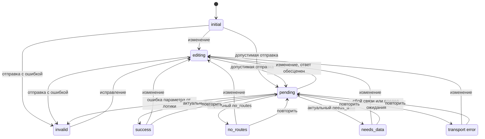

# Спецификация команды UI: форма повторного расчёта поездки — before

**Ветка:** `practice_05`.

**Общая фича:** `specs/001-trip-planner-form`.

**Дата:** 22.10.2026.

**Статус:** независимый первичный Draft команды UI, этап 3 ДЗ 5. Это предложение к согласованию, не принятый общий контракт и не разрешение на реализацию. Версия `before` сохраняется; последующие согласованные решения относятся к версии `after`.

**Входная история:** пользователь меняет окно выхода по Москве, запас на посадку и число вариантов одного подготовленного учебного маршрута, чтобы повторить настоящий расчёт без редактирования JSON и без запроса к LLM.

Документ использует порядок обязательных разделов шаблона Spec Kit: сценарии и приёмка → требования и данные → измеримые исходы → допущения. Затем приведены границы, открытые решения и источники. Workflow создания фичи не запускается: общие spec, checklist, constitution и настройки остаются у координатора.

## 1. Пользовательские сценарии и приёмка

### UI-US-001 — пересчитать подготовленную поездку (приоритет P1)

Как пользователь локального планировщика, я хочу видеть учебный маршрут и его ограничения, изменить четыре параметра расчёта и получить понятный ответ, включая причины отсутствия вариантов.

**Почему P1:** это единственная новая пользовательская история данного экрана; без неё пользователь продолжает менять JSON вручную.

**Независимая проверка после реализации:** открыть локальную форму, выполнить сценарии ниже через клавиатуру и настоящий расчёт ДЗ 4. Ни реализация UI, ни такой прогон пока не выполнены. Сохранённый baseline подтверждает только поведение существующего ядра.

| Сценарий | Дано | Когда | Тогда, наблюдаемо в UI | BRIEF |
| --- | --- | --- | --- | --- |
| UI-AS-001 | Открыт экран с исходным снимком | Пользователь читает форму до отправки | Видны «Учебная точка А → Учебная точка Б», «Учебные данные», расписание на 14.10.2026, московское время; значения 14.10.2026 06:00–12:00, 10 минут, 5 вариантов; результата ещё нет | AC1 |
| UI-AS-002 | Исходные значения | Нажатие «Рассчитать» | Сначала ожидание, затем один вариант: выход 14.10.2026 09:35, прибытие 11:50, 135 минут, ожидание 10 минут, 0 пересадок; видны участки, предупреждения и источник | AC1, AC5 |
| UI-AS-003 | Тот же снимок и окно | Запас изменён на 20 и выполнен новый расчёт | Выход 09:25, прибытие 11:50, 145 минут, ожидание 20 минут; старые 09:35 не показаны как новый результат | AC2 |
| UI-AS-004 | Конец 14.10.2026 09:00 раньше начала 10:00 | Отправка, затем исправление окна на 06:00–12:00 и повтор | Понятная ошибка у конца окна; введённое сохранено; после исправления доступен успешный расчёт без перезагрузки | AC2 |
| UI-AS-005 | Пустое числовое поле, дробь, текст либо значение вне границ | Отправка, затем исправление | У соответствующего поля есть объяснение и допустимый диапазон; пустота не стала нулём; повторный расчёт доступен | AC2 |
| UI-AS-006 | Окно 14.10.2026 09:36–10:00, запас 10 | Расчёт | Состояние `no_routes`: «В этом окне нет подходящих вариантов среди переданных подтверждённых цепочек»; нет утверждения об отсутствии транспорта вообще | AC3, AC5 |
| UI-AS-007 | Окно 15.10.2026 06:00–12:00 и исходный снимок | Расчёт | Состояние `needs_data`: не хватает подтверждённых данных на запрошенную дату; показаны причина, исходная дата расписания и предупреждения; рейсы не перенесены на 15 октября | AC4, AC5 |
| UI-AS-008 | Ядро вернуло `ok`, `search_scope.complete=false` и вариант | Отображение ответа | Состояние `success` с вариантом и явным сообщением «Покрытие данных неполное»; предупреждения и область поиска сохранены | AC5 |
| UI-AS-009 | Окно 14.10.2026 09:35–09:35, запас 10 | Расчёт | Тот же вариант 09:35–11:50: равные границы и выход ровно на границе допустимы | AC1, AC2 |
| UI-AS-010 | Зона компьютера отличается от Москвы | Открытие, отправка исходных значений и чтение ответа | На экране остаются 06:00–12:00 и 09:35–11:50 по Москве; не происходит пересчёта по зоне компьютера | AC2 |
| UI-AS-011 | Расчёт ожидается | Повторное нажатие для той же редакции формы | Второй расчёт не запускается, виден статус ожидания | AC2, AC5 |
| UI-AS-012 | Запрос A с запасом 10 ещё выполняется | Пользователь меняет запас на 20, отправляет B; ответы приходят в любом порядке | Отображается только ответ B, соответствующий текущим полям; ответ или ошибка A не заменяет его | AC2, AC5 |
| UI-AS-013 | Нет ответа локального адаптера либо ответ непригоден для чтения | Расчёт, затем восстановление связи и повтор | Понятная ошибка связи, поля сохранены; повтор возможен; ошибка не названа `no_routes` или `needs_data` | AC2, AC5 |
| UI-AS-014 | Пользователь работает только клавиатурой | Проходит форму, исправляет ошибку, отправляет и читает итог | Доступны все поля, кнопка, ошибки, участки и ссылки; фокус виден; ожидание и итог объявляются без обязательного использования мыши | AC1–AC5 |

UI-AS-008 — сценарий приёмки отображения поддерживаемого ответа, а не новая настройка покрытия для пользователя. Для него пригоден контролируемый ответ/тестовый стенд. Baseline с изменённым покрытием подтверждает существующее ядро; сам по себе он не доказывает сквозную работу будущей формы.

### Граничные случаи

- Начало и конец включены. Равенство допустимо; конец раньше начала ошибочен и не означает автоматический переход на следующие сутки.
- Пользователь может задать другую календарную дату. Неподдержанная снимком дата — допустимые параметры с возможным `needs_data`, а не ошибка поля. Прошлая относительно сегодняшнего дня дата не запрещается.
- Запас 0 и 1440, число вариантов 1 и 5 допустимы; −1/1441 и 0/6 соответственно недопустимы. Допустимость параметров не обещает наличие результата.
- При лимите 5 и одном найденном варианте показывается один вариант; список не дополняется вымышленными результатами.
- `null` длительности нельзя отображать как 0 минут. Неполное покрытие не тождественно отсутствию вариантов.
- Поздний ответ, поздняя ошибка и ответ после возврата полей к старым значениям должны пройти проверку актуальности запроса, а не только сравнение значений.
- Недоступность адаптера не доказывает отсутствие маршрута или нехватку исходных расписаний.

## 2. Требования

### 2.1. Основания: факты, уже существующие в проекте

Следующие факты прочитаны в общих материалах и исходниках; они не являются предложениями новой серверной схемы.

- **F-001:** `models.py` задаёт московскую зону, целые `boarding_buffer_minutes` 0–1440 и `max_options` 1–5; `departure_window.end` не раньше `start`. `parse_request` сообщает `InputError` с путём поля. `PlanResult.status` имеет ровно `ok`, `no_routes`, `needs_data`.
- **F-002:** `planner.py` возвращает `options`, `warnings`, `sources`, `data_kind`, `search_scope`. Признак полноты находится в `search_scope.complete`, а не в отдельном корневом поле. `ok` возможен при `complete=false`. Порядок вариантов уже определяет ядро.
- **F-003:** `search_scope` содержит переданные `chains`, фактическое `departure_window`, `max_scheduled_stages=3`, `complete` и `claim` о лучших вариантах среди переданных проверенных цепочек. Это не поиск по всей сети.
- **F-004:** Метрики ожидания и пересадок относятся к участкам с расписаниями. Метро внутри оценочного подхода не прибавляет отдельную пересадку к `transfer_count`.
- **F-005:** Fixture содержит `training-route`, точки «Учебная точка А/Б», источник `synthetic` с `mode=fixture`, `verified=true`, `checked_at=2026-10-07T12:00:00+03:00`, `valid_dates=[2026-10-14]`. Это вымышленные данные, даже при технической отметке `verified=true`.
- **F-006:** В fixture подход — оценочные 55 минут, автобус — 10:40–11:40, выход к цели — оценочные 10 минут. Сохранённый baseline даёт исходные 09:35–11:50/135 минут и при запасе 20 — 09:25–11:50/145 минут; он подтверждает также два отрицательных окна, включённую границу, ошибки и неполное покрытие.
- **F-007:** `sources.py` читает снимок без изменения дат и подтверждений; CLI использует это чтение и ядро, ошибочный ввод даёт exit 2. MCP `server.py` вызывает то же ядро. Готового HTTP-контракта эти файлы не задают.

### 2.2. Функциональные требования команды UI

Слово «должен» в UI-FR ниже означает **проверяемое предложение команды UI для этапа 4**. Оно не подменяет принятие общего контракта человеком. Объём, запрет второго расчётного ядра и честное отображение данных уже заданы BRIEF и constitution.

| ID | Требование | Проверка / BRIEF |
| --- | --- | --- |
| UI-FR-001 | Экран должен показывать только один подготовленный маршрут, его точки, дату расписания 14.10.2026, отметку проверки источника 07.10.2026 12:00 МСК и заметную пометку «Учебные данные: вымышленный пример, не реальное расписание» | UI-AS-001, AC1, AC5 |
| UI-FR-002 | Начальные значения должны поступать из подготовленного снимка: 14.10.2026 06:00–12:00, запас 10, лимит 5. Открытие формы не запускает расчёт автоматически и не подставляет сегодняшнюю дату | UI-AS-001, AC1 |
| UI-FR-003 | Пользователь должен менять начало и конец окна, запас и число вариантов. Подпись должна объяснять, что окно относится к выходу из начальной точки, а не к отправлению автобуса | UI-AS-002–007, AC1–AC4 |
| UI-FR-004 | Все введённые и выведенные даты/часы должны трактоваться по `Europe/Moscow`, отображаться в 24-часовом виде с явной подписью «Московское время (МСК, UTC+03:00)»; зона компьютера не должна менять значения | UI-AS-010, AC2 |
| UI-FR-005 | Отправка должна проверять обязательность, корректность даты/времени, целые числовые значения и их границы, а также порядок окна. Нельзя исправлять значение догадкой, округлять дробь, заменять пустоту нулём или переносить конец на следующий день | UI-AS-004–005, 009, AC2 |
| UI-FR-006 | Ошибка должна быть связана с соответствующим полем, объяснять исправление и сохранять введённое. Общая ошибка без доступного поля должна появляться рядом с формой. После исправления должен быть доступен повтор | UI-AS-004–005, AC2 |
| UI-FR-007 | Только явная отправка кнопкой «Рассчитать» или обычной отправкой формы с клавиатуры должна инициировать вычисление. UI должен передавать параметры локальной логике; вычислять маршруты, длительности и ранжирование в браузере нельзя | UI-AS-002–003, 014, AC1–AC2 |
| UI-FR-008 | Для актуального запроса должен быть виден `pending` с текстом «Рассчитываем…»; повторная отправка неизменённой редакции должна быть заблокирована | UI-AS-011, AC2 |
| UI-FR-009 | Редактирование во время запроса должно быть доступно, отменять актуальность ожидаемого ответа и возвращать форму в `editing`. Новый расчёт требует явной отправки; UI принимает только ответ последнего запроса текущей редакции | UI-AS-012, AC2, AC5 |
| UI-FR-010 | После любого изменения полей прежний итог должен исчезать из области актуального результата. Во время нового запроса и после ошибки он не должен выдаваться за ответ на новые значения | UI-AS-003, 012–013, AC2 |
| UI-FR-011 | При `ok` UI должен показать все полученные варианты в порядке ядра, не более заданного лимита, с выходом, прибытием, полным временем, ожиданием, пересадками и последовательностью участков | UI-AS-002–003, AC1–AC2, AC5 |
| UI-FR-012 | Участок должен сохранять описание, начало/конец, минуты, доступные названия остановок и связь с источником; `estimated=true` и имеющееся `basis` должны быть читаемы как оценка и её основание. Отсутствие основания/длительности не должно порождать выдуманное значение | UI-AS-002, AC1, AC5 |
| UI-FR-013 | При `no_routes` UI должен объяснять отсутствие подходящих вариантов только среди переданных подтверждённых цепочек; при `needs_data` — нехватку подтверждённых данных, сохраняя конкретные причины ядра | UI-AS-006–007, AC3–AC5 |
| UI-FR-014 | `ok` с `search_scope.complete=false` должен оставаться успешным результатом с вариантами и видимым предупреждением о неполноте; UI не должен вычислять полноту по длине списка или по одному статусу | UI-AS-008, AC5 |
| UI-FR-015 | Для всех трёх расчётных исходов UI должен сохранять все `warnings`, `sources`, `data_kind` и содержимое области поиска. Предупреждения о вымышленных данных и оценочных участках нельзя скрывать при успехе | UI-AS-002, 006–008, AC5 |
| UI-FR-016 | Изменение окна/запаса/лимита не должно менять рейсы, `valid_dates`, `checked_at`, `verified` или длительности снимка. UI не должен предлагать загрузку или исправление снимка пользователем | UI-AS-003, 007, AC2, AC4–AC5 |
| UI-FR-017 | Ошибка связи, непригодный ответ и превышение согласованного времени ожидания должны давать отдельное состояние `transport error` с сохранением полей и возможностью повторить действие. Автоматической повторной отправки нет | UI-AS-013, AC2, AC5 |
| UI-FR-018 | Серверная проверка остаётся обязательной независимо от проверки формы. Ошибка ввода не должна становиться четвёртым статусом `PlanResult`; неизвестный статус не должен трактоваться как успех или отсутствие маршрутов | UI-AS-004–005, 013, AC2, AC5 |
| UI-FR-019 | Форма должна оставаться доступной с клавиатуры: связанные подписи, логичный порядок фокуса, видимый фокус, текстовые ошибки и объявления ожидания/итога. Цвет не должен быть единственным носителем смысла | UI-AS-014, AC1–AC5 |
| UI-FR-020 | При ошибке отправки фокус должен переходить к первому ошибочному полю; завершение расчёта должно объявляться без неожиданного перемещения фокуса из редактируемого поля. Ссылки на источники должны иметь понятные подписи | UI-AS-004–005, 012, 014, AC2, AC5 |

### 2.3. Один экран: содержание и порядок

1. Заголовок «Расчёт времени выхода», точки маршрута, постоянная учебная пометка. Под ней — дата расписания снимка и отдельная отметка проверки источника. Это разные сведения; ни одно не называется текущей проверкой реального расписания.
2. Обычная форма с пояснением «Окно выхода из начальной точки. Всё время — московское» и полями ниже. Даты и время можно вводить с клавиатуры; использование календаря не обязательно.
3. Кнопка «Рассчитать», текст текущего состояния и область ошибок формы.
4. Область актуального результата: итоговый исход, параметры выполненного расчёта, варианты с участками либо причина отсутствия варианта. Ниже в той же области — предупреждения, источники и область поиска. Существенные предупреждения не спрятаны за обязательным раскрытием.

| Поле / подпись | Начальное значение | Правило и подсказка |
| --- | --- | --- |
| «Начало окна выхода, МСК» — дата и время | 14.10.2026, 06:00 | Обязательные календарная дата и время; окно включает границу |
| «Конец окна выхода, МСК» — дата и время | 14.10.2026, 12:00 | Обязательные дата и время; конец не раньше начала, равенство допустимо |
| «Запас на посадку, минут» | 10 | Целое 0–1440; отдельный запас перед первым участком с расписанием |
| «Число вариантов, не более» | 5 | Целое 1–5; найденных вариантов может быть меньше |

Предложение UI: точность ввода — минута; отправляемые границы соответствуют ровно `HH:MM:00`, конец не расширяется до последней секунды минуты. Видимая дата записана как `ДД.ММ.ГГГГ`; календарный виджет браузера может использовать системный формат, поэтому подписи и пояснения должны однозначно связывать значение с датой и московским временем. Формат передачи ещё требует согласования (UI-Q-001).

После успеха рядом с результатом показывается сводка фактически использованных параметров. Это помогает отличить новый результат от набранных, но ещё не отправленных значений. При редактировании актуальная сводка и результат очищаются, появляется «Параметры изменены — нажмите “Рассчитать”».

Для исходного сценария последовательность из ответа ядра читается так:

| Время 14.10.2026, МСК | Участок | Длительность и пояснение |
| --- | --- | --- |
| 09:35–10:30 | Пешком и метро до автобуса | 55 минут, оценка; основание «Вымышленная оценка для теста» |
| 10:30–10:40 | Запас на посадку | 10 минут |
| 10:40–11:40 | Учебный автобус, Учебная остановка А → Учебная остановка Б | 60 минут, ссылка на источник `synthetic` |
| 11:40–11:50 | Пешком до цели | 10 минут, оценка; основание «Вымышленная оценка для теста» |

Это ожидаемое отображение сохранённого ответа, а не расчёт UI. Метрики подписаны «Полное время: 135 минут», «Ожидание на участках с расписаниями: 10 минут», «Пересадки между участками с расписаниями: 0». Дополнительное пояснение сообщает, что ожидание и пересадка внутри оценочного городского подхода включены в его оценку.

Источник показывается как учебная ссылка `synthetic` на URL из снимка, с режимом `fixture`, применимой датой и отметкой проверки. `verified=true` объясняется как подтверждение внутри учебного снимка, не как проверка реального транспорта. Для `data_kind=mixed` сохраняется сообщение о наличии вымышленных данных; для `real` отображение всё равно не обещает актуальность без новой проверки. Нового выбора источников и режимов на экране нет.

Область поиска показывает `claim`, переданные ID цепочек, окно, предельное число участков с расписаниями и полноту. Человеко-понятная подпись обязательна: «Лучшие среди переданных проверенных цепочек; не поиск по всей транспортной сети». Для `complete=false` видна отдельная пометка неполноты вместе с исходными предупреждениями.

### 2.4. Ошибки поля и исправление

| Условие | Предлагаемый текст / место | Исправление пользователем |
| --- | --- | --- |
| Нет даты или времени, календарное значение неверно | «Укажите корректные дату и время по Москве» у конкретной части начала/конца | Заполнить или исправить эту часть; остальные значения сохранены |
| Конец раньше начала | «Конец окна должен быть не раньше начала» у конца, со связью с началом | Исправить дату/время конца или начала; UI не меняет сутки сам |
| Пустой, дробный, нечисловой или выходящий за границы запас | «Введите целое число минут от 0 до 1440» у запаса | Ввести допустимое целое, включая 0 при намеренном выборе |
| Неверное число вариантов | «Введите целое число от 1 до 5» у лимита | Ввести допустимое целое |
| Адаптер вернул ошибку известного параметра | Русское сообщение у поля; серверная причина доступна в понятной форме | Исправить поле и отправить заново |
| Ошибка относится к подготовленным данным, а не к редактируемому полю | Общее сообщение «Не удалось обработать подготовленные данные» и безопасное объяснение | Поля не помечаются ошибочными без основания; пользователь может повторить, исправление снимка относится к сопровождению |

После первой неудачной отправки исправленное поле повторно проверяется и его устранённая ошибка убирается; ошибки других полей не исчезают без исправления. Простое редактирование до первой отправки переводит форму в `editing`, без преждевременного объявления каждой неполной цифры ошибкой. Показ содержимого ввода как обычного текста не должен превращать его в разметку. В пользовательском сообщении не нужны traceback, пути серверных файлов или shell-команды.

### 2.5. Состояния экрана и повторные действия

`initial`, `editing`, `invalid`, `pending`, `success` и `transport error` — состояния представления. `no_routes` и `needs_data` здесь также обозначают отображение одноимённых исходов ядра. Полный набор из восьми состояний **не является** расширением `PlanResult.status`.

| Состояние | Что видно | Доступные действия и переход |
| --- | --- | --- |
| `initial` | Загружены сведения снимка и начальные значения, расчёта нет | Редактировать → `editing`; отправить → проверка, затем `pending` или `invalid` |
| `editing` | Текущие поля; прежнего итога нет; предложение выполнить расчёт | Продолжать ввод; отправить → `pending` либо `invalid` |
| `invalid` | Сохранённые поля, сообщения и фокус первого ошибочного поля | Исправить; после локальной проверки отправить заново. Ошибка от адаптера также возвращает сюда, если это ошибка параметра |
| `pending` | «Рассчитываем…», итог не показан; кнопка для текущей редакции недоступна | Поля редактируются; изменение → `editing` и обесценивание ответа; актуальный ответ → соответствующий исход; ошибка связи → `transport error` |
| `success` | Варианты из `ok`, предупреждения, источники, область поиска; возможна неполнота | Изменить поля → `editing`; повторить с теми же значениями → новый `pending` |
| `no_routes` | Объяснение отсутствия вариантов в ограниченной области поиска, предупреждения и источники | Изменить окно/параметры или повторить; снимок не изменяется |
| `needs_data` | Объяснение недостающих подтверждений, предупреждения и источники | Изменить параметры на покрытую дату или повторить; кнопки получения живого расписания нет |
| `transport error` | «Не удалось получить результат от локального сервиса. Повторите расчёт», поля сохранены | Повторная явная отправка → `pending`; редактирование → `editing` |

Предложение UI по запросам: каждая отправка получает локальный уникальный номер и неизменяемый снимок параметров с номером редакции формы. Отображается ответ только последней отправки и только при совпадении текущей редакции. Любое редактирование обесценивает предыдущий запрос, даже если пользователь затем вернул старые значения. Это правило относится и к ошибкам, и к завершению ожидания. Оно не требует серверной отмены; физически старый запрос может ещё выполняться.

В `pending` повторное нажатие для той же редакции не отправляет запрос. После редактирования пользователь может отправить новую редакцию, не дожидаясь старого ответа. Автоматического расчёта при вводе нет. Предложение UI: через 10 секунд без пригодного ответа текущий запрос завершается для пользователя ошибкой связи; его поздний ответ игнорируется. Этот предел и политика конкурирующих запросов ещё должны быть приняты совместно (UI-Q-003).

Поздний неактуальный ответ не вызывает перехода вообще. Если после исправления пользователь сразу отправляет допустимую форму, `editing` может быть кратким внутренним состоянием. Диаграмма описывает уже инициализированную форму; способ получения начальных сведений относится к UI-Q-001. Ошибка их получения должна иметь понятный повтор загрузки на том же экране и не открывать расчёт с выдуманными начальными данными.

### 2.6. Сущности и данные, ожидаемые от логики

Это семантические потребности UI и предложения для общего контракта. Они не фиксируют HTTP-пути, методы, коды ответа или окончательные имена полей обёртки.

| Сущность | Нужные UI сведения | Основание / ответственность |
| --- | --- | --- |
| Описание подготовленной поездки | Точки, происхождение `fixture`, применимые даты, отметки источников, начальные окно/запас/лимит | Сведения существующего снимка; логика предоставляет согласованный способ инициализации без произвольного пути от клиента |
| Редактируемые параметры | Начало, конец, запас, лимит; всегда московская семантика времени | UI хранит текст редактирования; логика проверяет нормализованный запрос через существующее ядро |
| Снимок отправки | Отправленные параметры и локальная редакция/номер запроса | Предложение UI для привязки результата; не новый объект маршрута и не сохранённая поездка |
| Результат расчёта | Неизменённая семантика `status`, `options`, `warnings`, `sources`, `data_kind`, `search_scope` | Фактический `PlanResult` ядра; адаптер не должен терять поля |
| Вариант и участок | Поля варианта, `timeline`, тип, времена, минуты, описание, остановки, `estimated`, `basis`, `source_id`, если присутствуют | Фактические данные ядра; UI форматирует и подписывает, не пересчитывает |
| Ошибка параметра | Привязка к одному из полей формы или общей форме и понятная причина | Предложение UI; сейчас ядро даёт текстовый `InputError`, схема ошибки обёртки не согласована |
| Неполнота | `search_scope.complete` плюс все `warnings`, независимо от наличия вариантов | Факт ядра; UI не заменяет его собственной эвристикой |

UI ожидает две смысловые операции: получить описание и исходные параметры единственного снимка; выполнить расчёт по четырём параметрам формы над тем же снимком. Первая операция может быть обеспечена при выдаче самой страницы либо отдельным чтением — решение не принято. Клиент не посылает расписание, `verified`, покрытие, источники или путь к файлу и не получает права менять их.

Для расчёта UI предлагает передавать точные моменты начала/конца с явным московским смещением и два целых числа; способ кодирования уточняется в UI-Q-001. Проверки UI служат понятной обратной связи, а `parse_request` и `plan_departures` остаются обязательными на стороне логики. Ошибка проверки возвращается отдельно от успешного расчётного результата; конкретная оболочка обсуждается в UI-Q-002. Если ошибка не привязана к доступному полю, UI ожидает общую безопасную диагностику и возможность повторить действие.

## 3. Измеримые критерии успеха

Критерии относятся к будущей реализации. Числа исходных результатов взяты из общего baseline; перечисленные UI-проверки пока не выполнены.

| ID | Измеримый исход | Связь |
| --- | --- | --- |
| UI-SC-001 | Исходный сценарий показывает ровно один существующий вариант 09:35–11:50, 135 минут, 10 минут ожидания, 0 пересадок; все четыре участка и источник доступны на одном экране | UI-FR-001–004, 011–012; AC1 |
| UI-SC-002 | После изменения запаса на 20 и одной отправки показаны 09:25–11:50 и 145 минут; ни одного значения из старой сводки не выдано за новый ответ | UI-FR-007–011; AC2 |
| UI-SC-003 | Два контрольных окна дают два различных объяснения: 14.10 09:36–10:00 — `no_routes`, 15.10 06:00–12:00 — `needs_data`; оба сохраняют ограничения и предупреждения | UI-FR-013, 015–016; AC3–AC4 |
| UI-SC-004 | Во всех проверках пустоты, дроби, неверного диапазона и обратного окна ошибка объяснена; исправление и следующая отправка доступны без перезапуска. Допустимы равное окно и крайние целые значения | UI-FR-005–006, 018; AC2 |
| UI-SC-005 | При смене зоны компьютера с Москвы на зону с иным смещением исходные поля и часы результата остаются теми же по Москве | UI-FR-004; AC2 |
| UI-SC-006 | При обоих порядках завершения A/B и при поздней ошибке A экран ни разу не заменяет текущий ответ B устаревшим. Двойная отправка неизменённой формы во время ожидания создаёт один актуальный запрос | UI-FR-008–010; AC2, AC5 |
| UI-SC-007 | Для каждого из трёх исходов показаны все предупреждения и источники ответа и вся область поиска; контрольный `ok` с неполным покрытием сохраняет вариант и пометку неполноты | UI-FR-014–015; AC5 |
| UI-SC-008 | Основной сценарий, исправление ошибки и повтор после сбоя выполняются полностью с клавиатуры; каждый контроль имеет подпись, фокус видим, состояние объявляется текстом | UI-FR-017, 019–020; AC1–AC5 |

### Матрица покрытия AC1–AC5

| Условие BRIEF | Требования UI | Сценарии | Граница доказательства |
| --- | --- | --- | --- |
| AC1 | UI-FR-001–004, 007, 011–012, 015, 019 | UI-AS-001–002, 009, 014 | Потребуется настоящий экран и расчёт; baseline даёт только ожидаемые числа |
| AC2 | UI-FR-003–010, 017–020 | UI-AS-003–005, 009–014 | Нужны проверки ошибки/исправления, зоны, ожидания и актуальности |
| AC3 | UI-FR-013, 015 | UI-AS-006 | Не заявлять отсутствие транспорта вообще |
| AC4 | UI-FR-013, 015–016 | UI-AS-007 | Сравнить снимок до/после; одного текста в UI недостаточно |
| AC5 | UI-FR-009–020 | UI-AS-002, 006–008, 011–014 | UI покрывает отображение и передачу параметров; регрессия CLI/MCP и неизменность ядра проверяются координатором отдельно |

## 4. Допущения и зависимости

- Один локальный пользователь, один подготовленный учебный маршрут; окно по умолчанию берётся из снимка независимо от текущей даты.
- Начальные сведения предоставляет логика над тем же снимком, который будет использован для расчёта; UI не содержит второй независимо редактируемой копии расписания.
- Существующие ядро и проверки ДЗ 4 остаются основой; браузер не добавляет собственную арифметику маршрута или собственный алгоритм полноты.
- Принятые ограничения стека соблюдаются: обычный HTML/CSS/JavaScript, тонкий локальный адаптер на loopback, без UI-фреймворка. Конкретный способ запуска и инструменты E2E относятся к будущему техническому планированию.
- Доступность, редактирование во время запроса, инициализация, форма ошибок и 10-секундный предел описаны как предложения UI, а не уже согласованные решения двух команд.
- Команда UI не проверяет актуальность внешних расписаний. Ссылка `example.org` остаётся признаком учебного источника, а не доказательством реальной поездки.

## 5. Границы работы и готовность к следующему этапу

Входит один экран расчёта, его поля, состояния, результаты и объяснения на основе фиксированных подготовленных данных. Не входят произвольные адреса, карта, геокодинг, живые API и расписания, загрузка файлов, редактирование покрытия/источников, БД, авторизация, сохранение поездок и облако. Повтор и восстановление после ошибки выполняются на том же экране.

Эта версия подготовлена только по общим материалам и роли UI. Спецификация и prompt другой команды не читались; обмена сообщениями с ней не было. Существующие факты ядра отделены от UI-предложений. Реальных расхождений между командами на этом этапе не установлено, поскольку сравнение ещё не выполнялось.

Документ готов как вход для согласования этапа 4. До кода нужны общий контракт, обе `after`-версии и решение человека по конкретным документам. В этой работе код приложения, исходники, тесты, evidence и общие документы не изменяются. Регрессия репозитория и сквозная проверка остаются у координатора; их успешность этой спецификацией не утверждается.

## 6. Открытые решения для команды логики и согласования

Это вопросы совместного проектирования, не обнаруженные ошибки существующего ядра.

| ID | Предложение UI | Что требуется согласовать | Последствие решения |
| --- | --- | --- | --- |
| UI-Q-001 | Получать сведения и исходные значения единственного снимка от логики; передавать границы с явным московским смещением, минутная точность, секунды 00 | Операции и формат инициализации/расчёта, точные поля сообщения, передача времени и способ связать описание снимка с используемыми данными. Предпочтение UI — явные ISO-моменты с `+03:00`; это не принятая HTTP-схема | Позволит исключить расхождение исходных данных и зависимость от зоны компьютера; определит восстановление при ошибке инициализации |
| UI-Q-002 | Разделять результат ядра, ошибки параметров с привязкой к полям и общие ошибки; не разбирать произвольный текст `InputError` в браузере | Оболочка ошибок, стабильное сопоставление путей начала/конца, запаса и лимита, безопасные общие сообщения, коды HTTP. Как адаптер преобразует фактическую текстовую диагностику ядра, пока не определено | UI сможет адресно объяснять исправление без добавления четвёртого расчётного статуса |
| UI-Q-003 | Оставить поля редактируемыми; повтор той же редакции блокировать, новую отправку разрешать; старые ответы отбрасывать по локальной редакции/номеру. Через 10 секунд — ошибка связи без автоматического повтора | Принять или скорректировать эту политику, предел ожидания и возможности адаптера при перекрывающихся запросах; требуется ли отражать идентификатор запроса в общей оболочке. UI не предполагает обязательной серверной отмены | Определит проверяемое поведение ожидания, повторного нажатия и позднего ответа; не расширяет пользовательскую историю |

## 7. Использованные общие источники

Все ссылки ниже локальные и относятся к разрешённому общему контексту; документы другой команды не используются.

1. [AGENTS.md](../../../../AGENTS.md) — правила локальной работы и проверки; текущую ветку ДЗ 5 уточняет прямое поручение и constitution.
2. [Constitution](../../../../.specify/memory/constitution.md) — одно ядро, честные данные, московское время, два независимых документа до кода, границы истории.
3. [Шаблон Spec Kit](../../../../.specify/templates/spec-template.md) — обязательные сценарии, требования, сущности, измеримые исходы и допущения.
4. [Skill speckit-specify](../../../../.agents/skills/speckit-specify/SKILL.md) — критерии качества и проверяемость; workflow адаптирован к прямому запрету создавать вторую общую feature-spec и checklist.
5. [BRIEF ДЗ 5](../BRIEF.md) — принятый объём, AC1–AC5, диапазоны и стек.
6. [Общая feature-spec](../../../../specs/001-trip-planner-form/spec.md) — общая история и её сценарии, ещё не контракт команд.
7. [README ДЗ 4](../../../practice_04/homework/README.md) — существующие точки входа, метрики и ограничения поиска.
8. [SOURCE_CHECK ДЗ 4](../../../practice_04/homework/SOURCE_CHECK.md) — различие датированных фактов, оценок и неподтверждённых сведений; исторический реальный пример не подставляется в учебную форму.
9. [models.py](../../../practice_04/homework/trip_planner/models.py) — валидация, входные ограничения и три статуса результата.
10. [planner.py](../../../practice_04/homework/trip_planner/planner.py) — фактические поля результата, участки, порядок, полнота и предупреждения.
11. [cli.py](../../../practice_04/homework/trip_planner/cli.py) — существующий вызов ядра и обработка ошибочного ввода.
12. [server.py](../../../practice_04/homework/trip_planner/server.py) — настоящий MCP-вызов того же ядра.
13. [sources.py](../../../practice_04/homework/trip_planner/sources.py) — чтение без переписывания сведений снимка.
14. [rare_connections.json](../../../practice_04/homework/tests/fixtures/rare_connections.json) — начальные значения, учебные точки и источник, фиксированные рейсы.
15. [baseline-scenarios.json](../evidence/baseline-scenarios.json) — сохранённые наблюдения существующего ядра; не свидетельство готовности UI или HTTP-интеграции.
