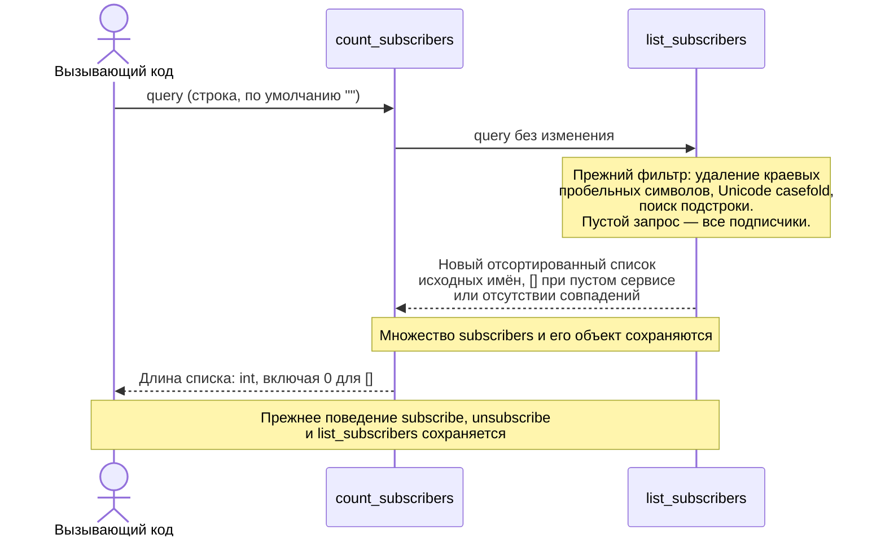

# Design

## Context

См. `proposal.md` и delta spec. Текущий `service.py` содержит подписку, отписку и фильтр `list_subscribers(query="")`; все 17 тестов демо защищают уже реализованное поведение. Подсчёта пока нет. Нужно выбрать между повторением правил фильтра в счётчике и делегированием существующему списку. Этот документ остаётся учебным черновиком без apply.

## Goals / Non-Goals

**Goals:** Оставить один источник правил сопоставления имён; возвращать число найденных подписчиков без изменения состояния и прежнего поведения функций.

**Non-Goals:** Отдельная нормализация для счётчика, оптимизация хранения, кэш и изменение контракта нестроковых аргументов. Реализация, sync и archive этого change не входят в часть 2.

## Decisions

- Добавить отдельный `count_subscribers(query="")`: существующий список продолжает возвращать список, вызывающий получает `int` отдельной операцией.
- Делегировать существующему `list_subscribers(query)` и посчитать длину результата. Альтернатива — второй цикл с дублированием фильтра — увеличивает риск расхождения правил поиска.
- Сохранить тип входа: строковый запрос. Новый способ обработки `None` и других типов не определяется.

### Interaction

## Risks / Trade-offs

- Повторение фильтра в двух местах → делегировать существующей функции и проверять равенство количества длине её результата.
- Получение списка включает создание и сортировку списка → для маленького демо принимается существующая стоимость; отдельная оптимизация не предлагается.
- Черновик можно принять за реализованную возможность → задачи реализации оставлены незавершёнными, основная spec и код не обновляются.
