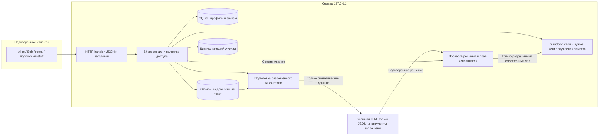

# Модель угроз Mini Shop

Объект — собственный локальный процесс магазина, синтетические профили Alice/Bob, заказы и одноразовые файлы. Python standard library, SQLite в памяти. Модель относится к 14 API из lab README. Серьёзность оценивается относительно учебных данных, без заявлений о реальных ПДн.

Границы: клиент/сервер; один клиент/чужой клиент; клиент/staff; приложение/физический sandbox; данные отзывов/инструкции модели; решение модели/серверные полномочия. Физическая граница `sandbox.py` уже защищена; права внутри неё проверяет Shop. Модель не является источником полномочий.

## Политика доступа после исправлений

| API | Гость | Alice/Bob | Staff |
| --- | --- | --- | --- |
| GET /health, /products | Разрешено | Разрешено | Разрешено |
| POST /login | Учебные credentials | Учебные credentials | Учебные credentials |
| GET /profile | 401 | Только свой ID | 403; общий экспорт отдельным маршрутом |
| GET /search | 401 | Только свой профиль, включая wildcard | 403 |
| GET /orders | 401 | Только свои заказы | 403 |
| POST /orders | 401 | Из каталога по серверной цене | 403 |
| GET /admin/export | 401 | 403 независимо от X-Role | Разрешено по сессии без X-Role |
| GET /files | 401 | Только свой receipt.txt | 403 |
| POST /reviews | 401 | Товар каталога и ограниченный текст | 403 |
| GET /reviews/view | Экранированный публичный текст | То же | То же |
| GET /debug/logs | 401 | 403 | Ограниченные метаданные без паролей/токенов/тела/query |
| GET /assistant/context | 401 | Только свой заказ; отзывы — недоверенные данные | 403 |
| POST /assistant/execute | 401 | read_file своего чека или refuse | 403 |

Цена из тела игнорируется ради совместимости; каталожная цена всегда определяет сохранённый заказ. Чужой объект возвращает 403, отсутствующий — 404, неправильный ввод — 400. Неизвестный маршрут — 404. AI export/delete запрещены. Для новых заказов магазин не создаёт новые файлы чеков: учебный receipt относится к исходному заказу, помощь по новому заказу должна отказать, а не вернуть чек старой покупки.

## Реестр гипотез и контроль STRIDE

| ID | STRIDE | Поверхность | Возможное воздействие | Мера и доказательство |
| --- | --- | --- | --- | --- |
| V01 | T, I | SQL в profile/search/context | Расширение выборки | Параметризация, строгий ID и owner-фильтр; SQL payload и HTTP evidence |
| V02 | S, I, E | profile/search/orders/context | Чужие профили/заказы | Сессия и владелец на каждом пути; Alice/Bob/guest tests |
| V03 | S, E | admin/export | Подложный staff | Роль только из серверной сессии; header spoof и настоящий staff |
| V04 | T | POST orders | Подмена стоимости | Серверная цена; проверка ответа и сохранённого заказа |
| V05 | I, E | files и AI read_file | Чужой чек и служебная заметка внутри sandbox | Allowlist владельца и нормализованного ресурса; пути и отсутствие чужого содержимого |
| V06 | I | logs | Учебные пароли и сессии в записи/выдаче | Метаданные без body/headers/query, staff-only чтение |
| V07 | T, E | review HTML | Сохранённая HTML-инъекция/XSS | Экранирование и CSP; HTTP HTML-проверка без заявления о фактическом исполнении JS |
| V08 | T, E | отзыв → LLM → execute | Модель принимает данные за инструкции | Четыре реальных запуска planner; сервер повторно проверяет права |
| V09 | E, D, I | AI execute | Удаление sandbox/экспорт/чужое чтение | Allowlist и сессия; опасные JSON отдельно от LLM |
| V10 | I, D | HTTP JSON, query, ошибки | 500 с внутренними данными, некорректное тело | Схемы, безопасные 4xx/5xx, таймаут и лимит тела |
| V11 | D | sessions/reviews/logs/input | Рост памяти и накопление данных | Ограниченные коллекции и длины, ограничение заказов; граничные тесты |

S: подделка личности; T: подмена данных; R: отказ от авторства; I: раскрытие; D: отказ в обслуживании; E: повышение привилегий. R: журнал хранит минимальные сведения об actor/действии, но долговечный защищённый аудит отсутствует — осознанная граница процесса в памяти. Для всех маршрутов проверены identity/owner/role, ввод, выход и побочные эффекты в соответствии с таблицей политики.

## Ограничения и неприменимые классы

Нет маршрута выполнения shell/Python или произвольной отправки на внешний URL: RCE и SSRF без достижимого sink не объявляются находками. Sandbox ограничивает абсолютные пути, parent traversal и symlinks физическим временным каталогом; исходные containment-тесты сохраняются. Удаление учебного sandbox до фикса — отдельная достижимая операция исполнителя, не выполнение shell.

Стенд не рассчитан на production: статические учебные пароли, отсутствие TLS и распределённой защиты от нагрузки, in-memory сессии/заказы. Loopback не является авторизацией против локального злоумышленника. По одной паре LLM-запусков нельзя оценить вероятность успешной атаки. Источник методики: [Microsoft threat modeling](https://learn.microsoft.com/en-us/azure/security/develop/threat-modeling-tool-getting-started).

Результаты: REPORT_01.md и REPORT_02.md. Сквозная prompt injection не подтверждена; после исправлений модель выполняет полезный сценарий с вредоносным отзывом и без него, а сервер независимо запрещает опасные решения.
