# ДЗ 7.2 со звёздочкой

[Классификатор `7.2_1`](7.2_1.json) · [Обработка Issues `7.2_2`](7.2_2.json) · [Недельный отчёт `7.2_3`](7.2_3.json)

**Классификация.** В запуске #4017 основной сценарий вызвал классификатор. Запуск #4018 вернул `feature` с уверенностью `0.9`. Лейблы видны в [тестовом репозитории](https://github.com/Artem037/ITMOv2/issues) на [`bug` (#14)](https://github.com/Artem037/ITMOv2/issues/14), [`task` (#16)](https://github.com/Artem037/ITMOv2/issues/16) и [`feature-request` (#17)](https://github.com/Artem037/ITMOv2/issues/17).

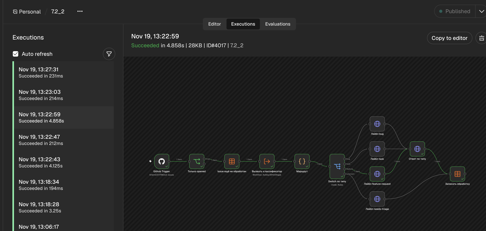

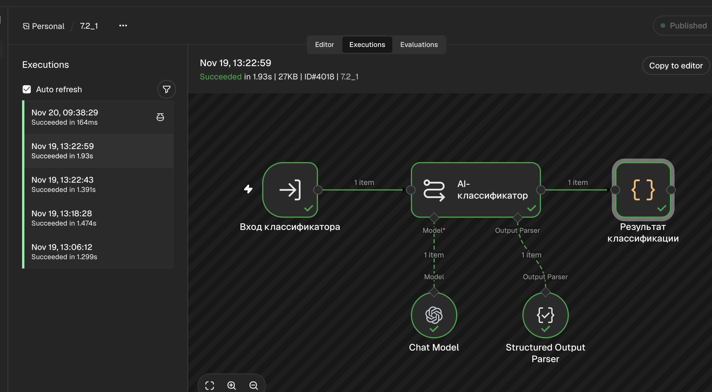

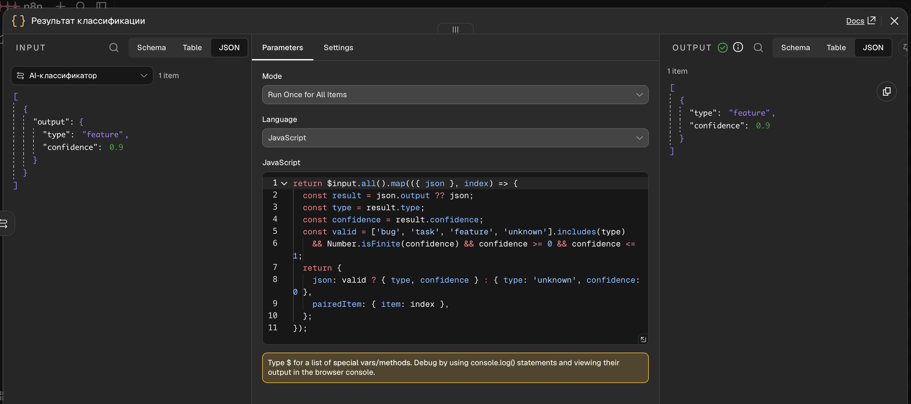

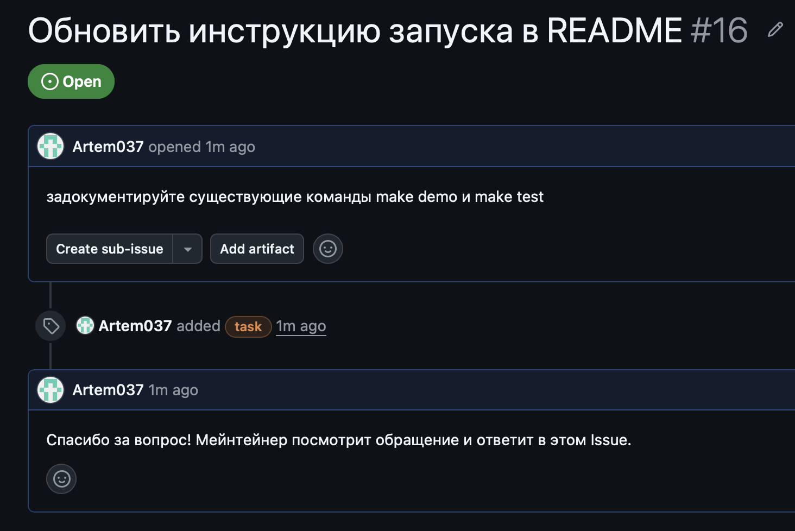

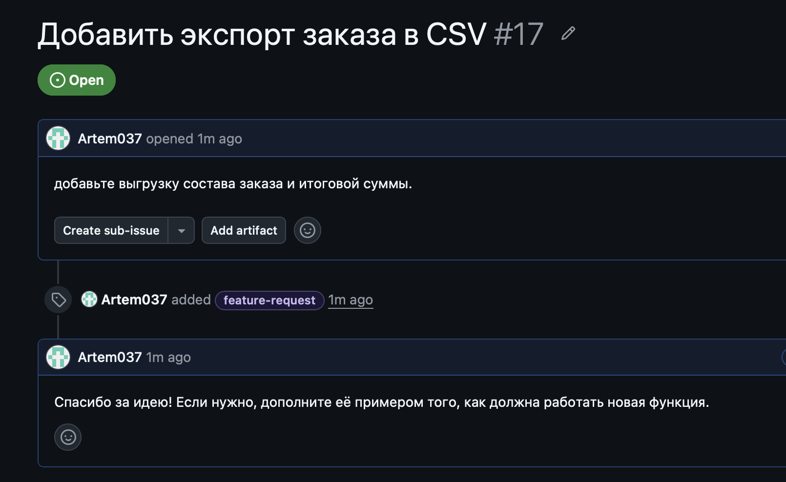

**Ручная проверка Issue.** Для Issue #15 классификатор вернул `unknown` с уверенностью `0.5`. В GitHub появился `needs-triage`, комментариев нет. [Issue #15](https://github.com/Artem037/ITMOv2/issues/15)

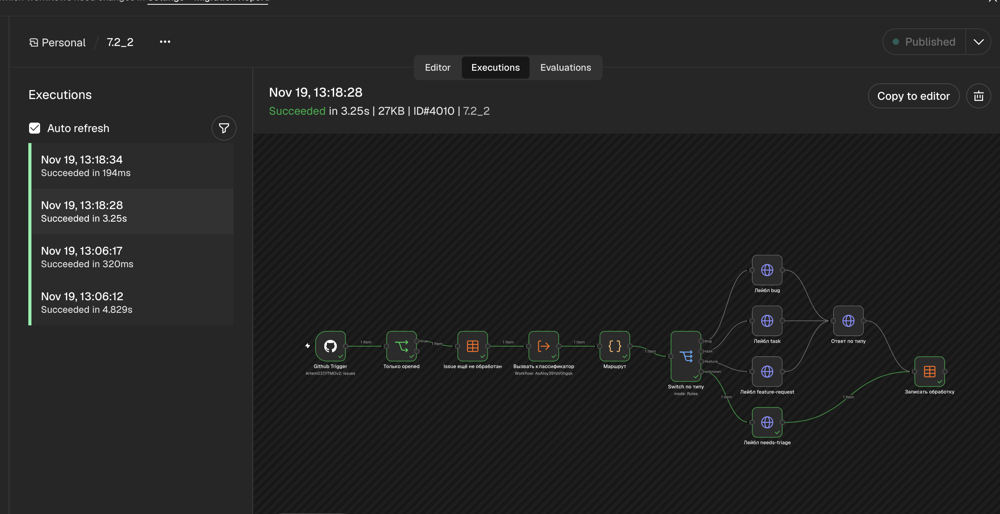

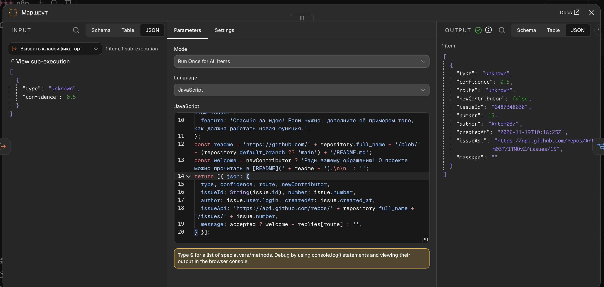

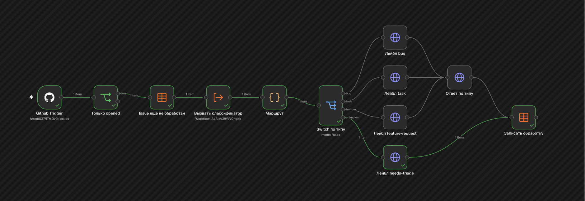

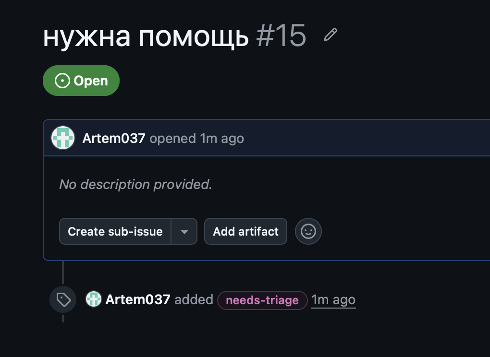

**Повторная доставка.** Запуск #4020 остановился на проверке `processed_issues`.

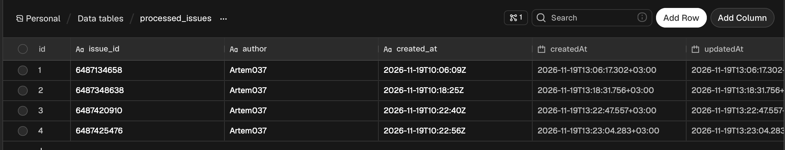

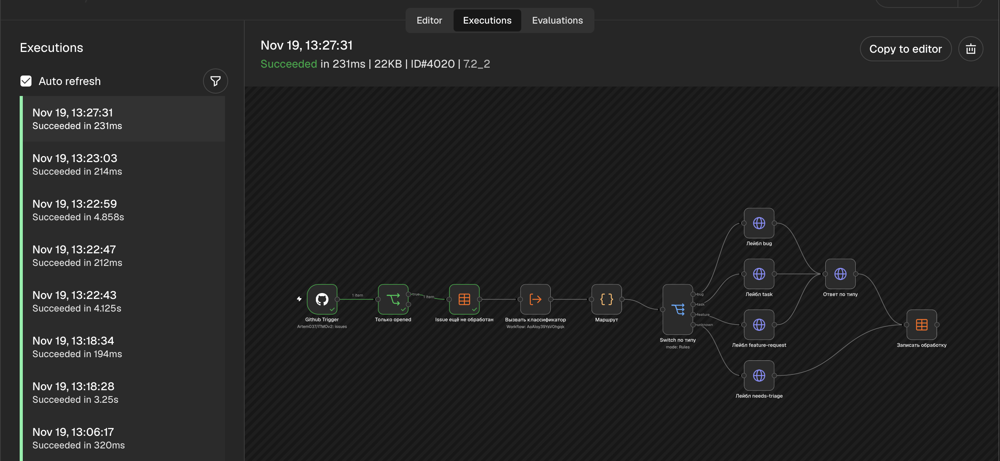

**Еженедельный отчёт.** В `7.2_3` задан Cron `0 9 * * MON`. Ручной запуск #5627 выполнил четыре запроса к GitHub и отправил HTML-письмо через Gmail SMTP.

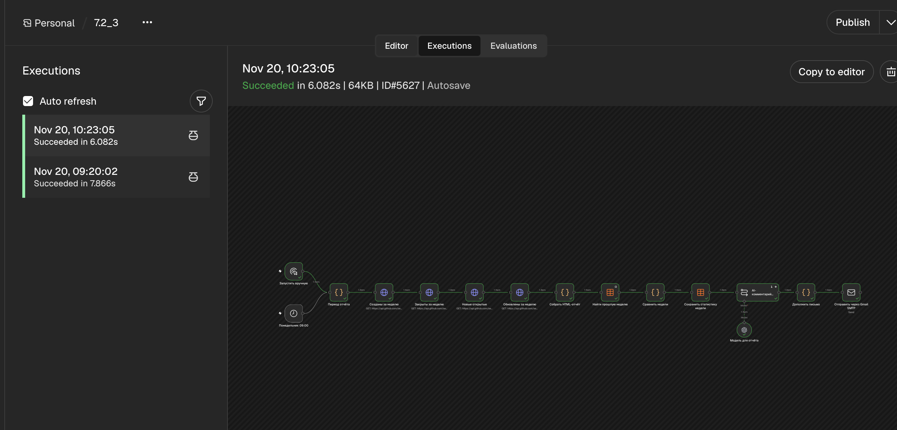

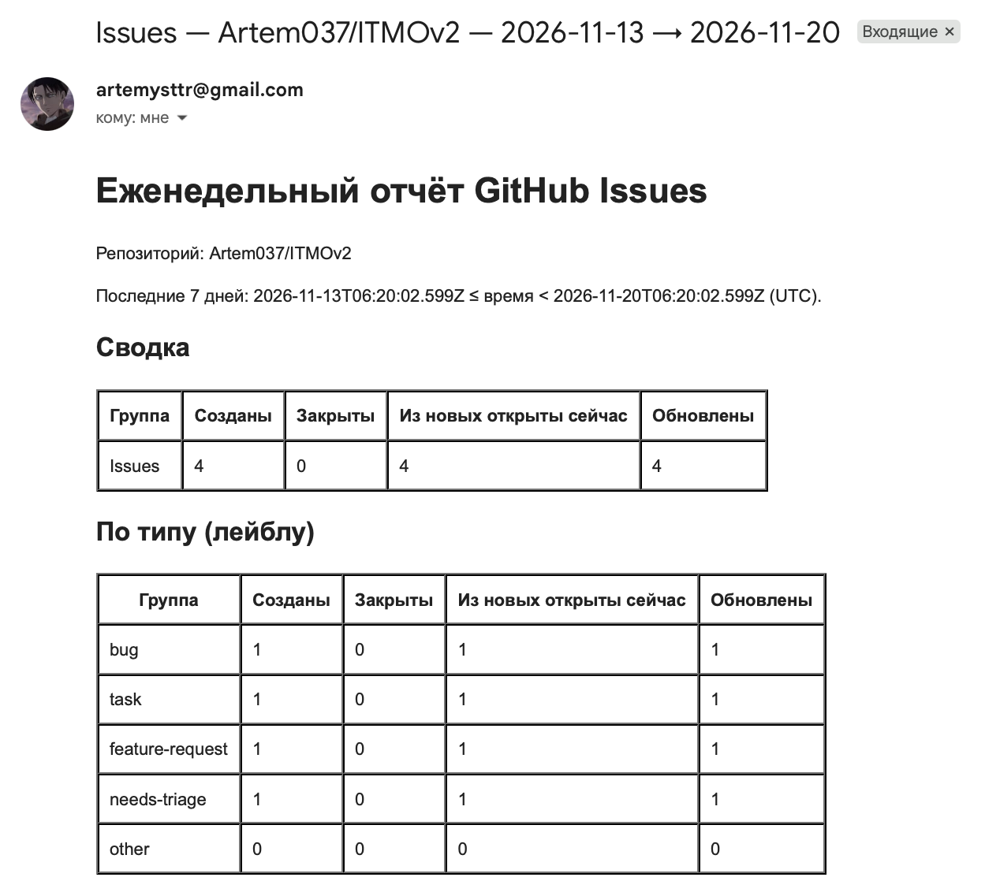

**Звёздочка.** В `weekly_issue_stats` есть демонстрационная запись за неделю с 9 ноября и статистика, сохранённая n8n за неделю с 16 ноября. В письме показана Δ по четырём метрикам (`+2`, `−1`, `+3`, `+1`) и комментарий модели.

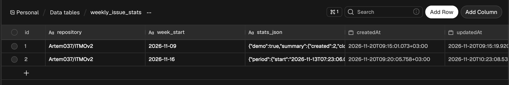

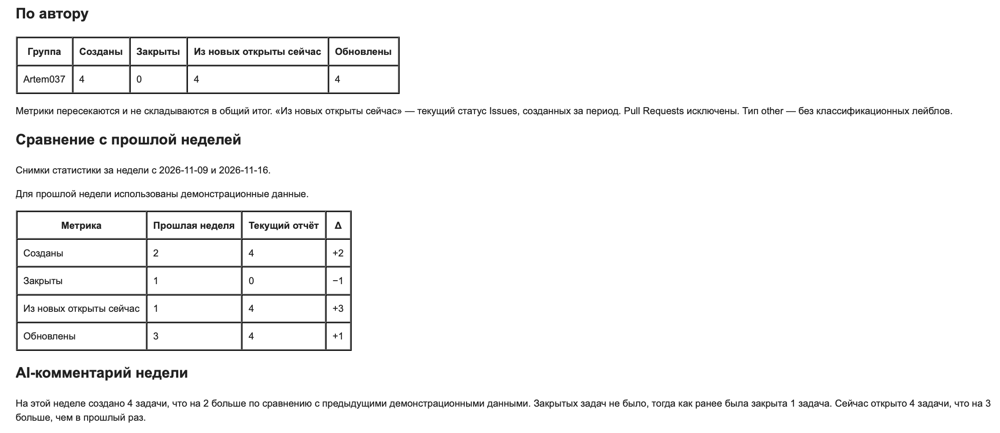
