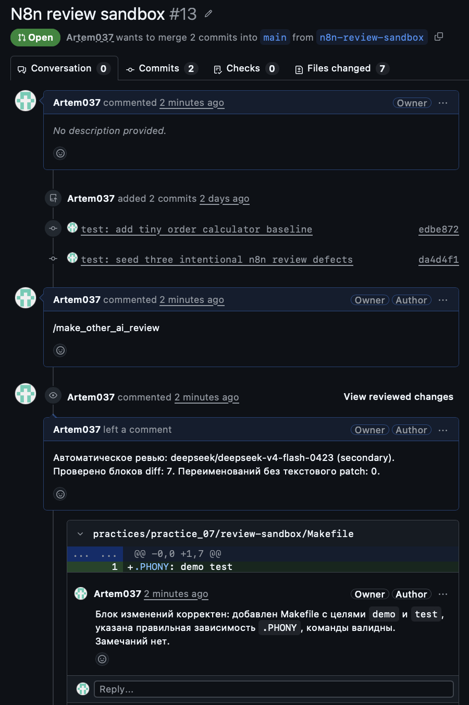
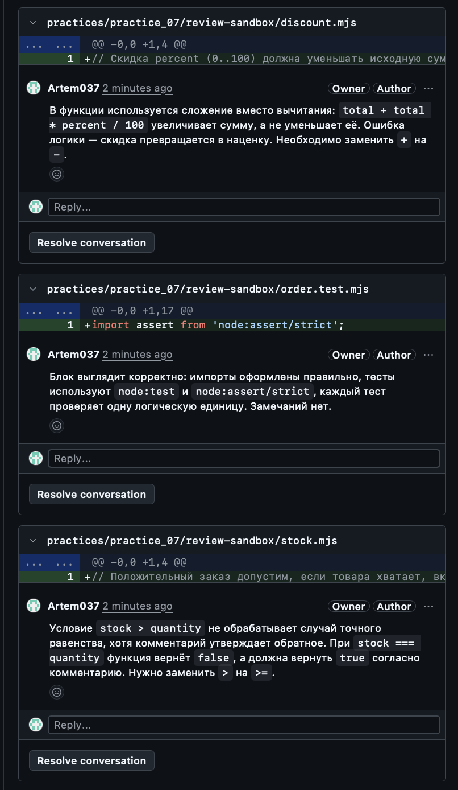
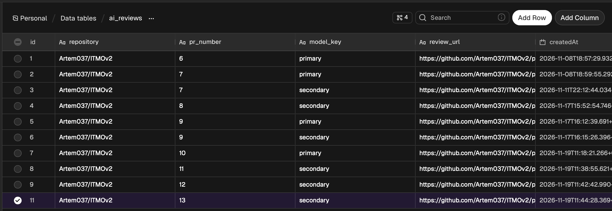
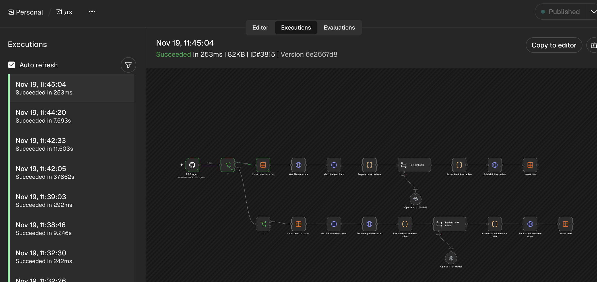

# ДЗ 7.1 · Проверка на PR №13

[JSON-экспорт workflow](workflow.json)

19 ноября 2026 · Workflow `7.1 дз`, версия `6e2567d8`.

**Ревью второй моделью и звёздочка.** Команда `/make_other_ai_review` запустила DeepSeek V4 Flash. Execution `3813` опубликовал одно ревью с 7 комментариями, по одному на каждый блок diff. [Ревью в GitHub](https://github.com/Artem037/ITMOv2/pull/13#pullrequestreview-5971826906)

**История.** В таблице `ai_reviews` появилась запись для PR `13` с `model_key = secondary`.

**Блокировка повтора.** После публикации в том же PR отправили `/make_ai_review`. Execution `3815` остановился на `If row does not exist`, до вызова модели и публикации. [Повторная команда в GitHub](https://github.com/Artem037/ITMOv2/pull/13#issuecomment-7004206000)

