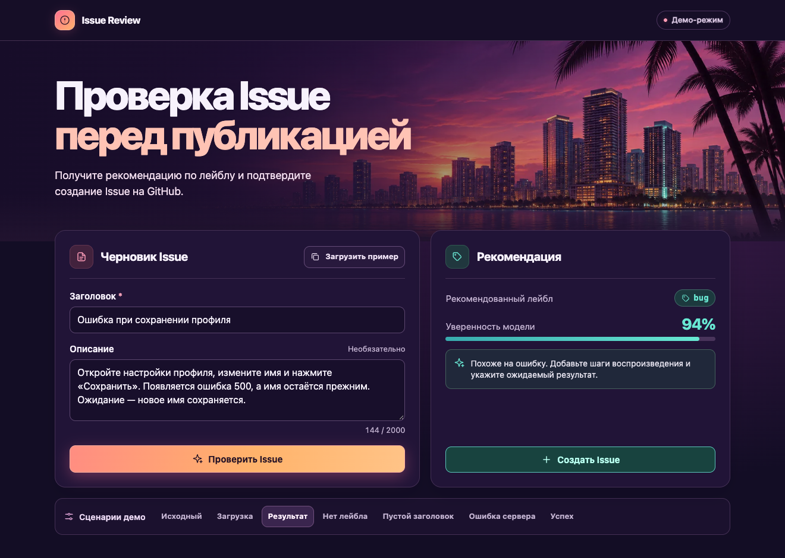
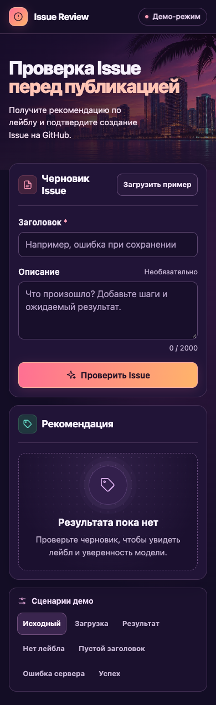
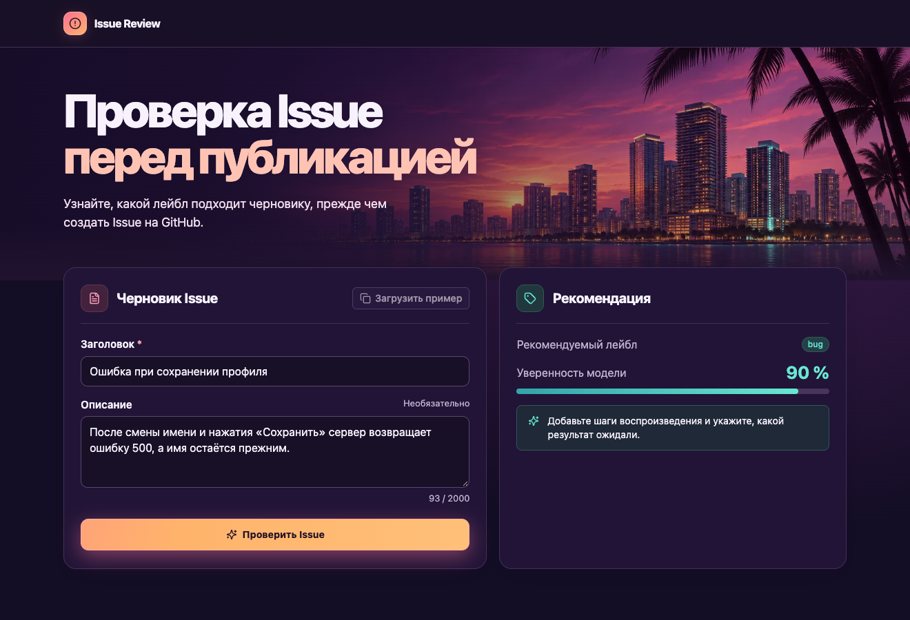
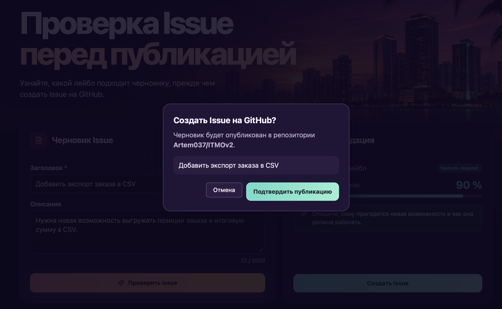
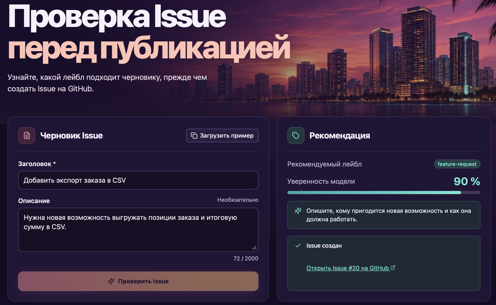
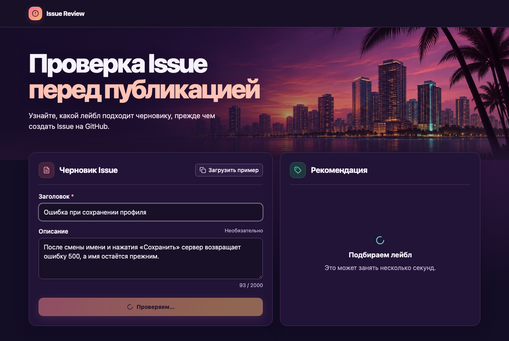
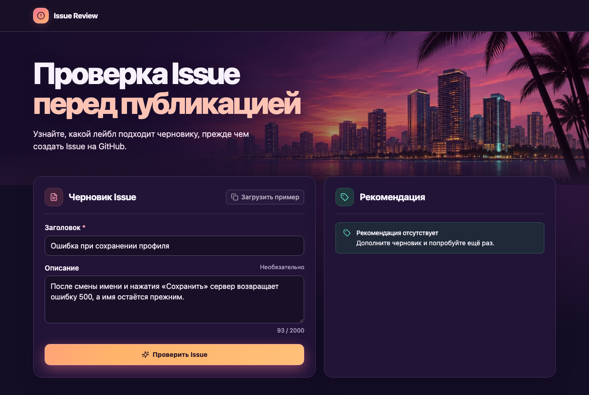
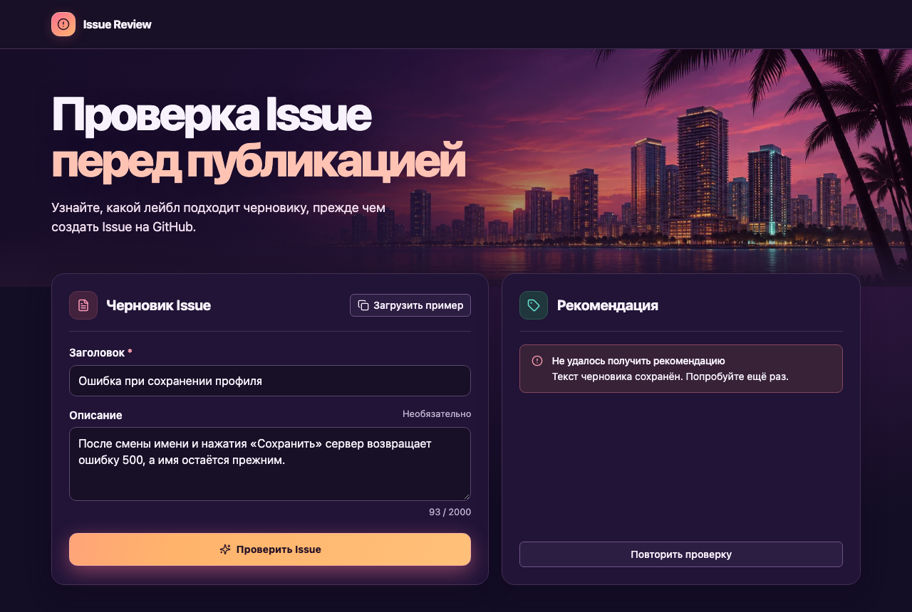
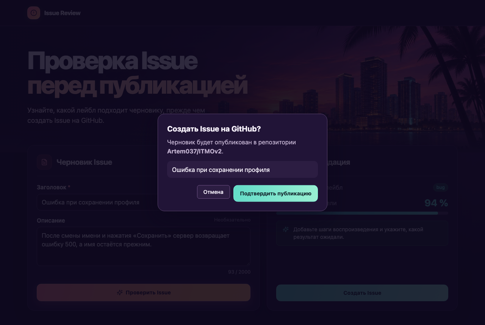
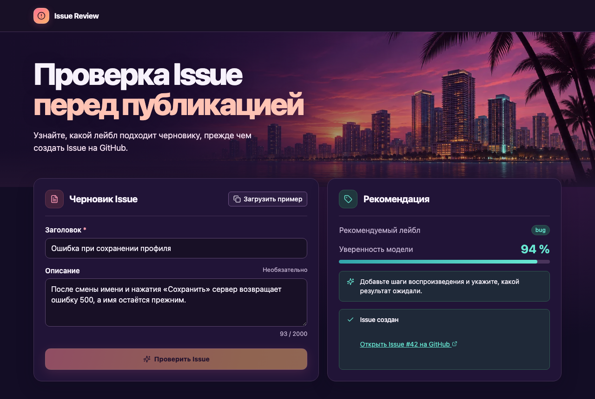

# Практика 8 · AI-прототип

## Результат

Интерактивный макет сервиса проверки черновика Issue перед публикацией. Переключатели «Сценарии демо» показывают исходную форму, загрузку, рекомендацию, пустой результат, валидацию, ошибку и успех. [Открыть HTML-прототип](issue-review.html)





## Рабочая форма

Фронтенд на React и shadcn/ui отправил черновик «Ошибка при сохранении профиля» в n8n. Workflow вызвал классификатор `7.2_1` и вернул `bug` с уверенностью 90%. Результат отобразился в форме. [Запуск №5881 в n8n](https://n8n-itmo.cyrweb.ru/workflow/rDd2SF51l336narL/executions/5881)



После рекомендации пользователь открывает диалог, сверяет заголовок черновика и подтверждает публикацию. Приложение отправляет заголовок и описание на отдельный защищённый webhook n8n и показывает полученную ссылку на Issue. [Экспорт сценария публикации](issue-create-api.json)

### Где заданы цвета, типографика и отступы

- [Цвета в `:root`](app/src/issue-review.css#L1)
- [Базовый шрифт и межстрочный интервал в `body`](app/src/issue-review.css#L20)
- [Расстояние между карточками и внутренние отступы карточек](app/src/issue-review.css#L90)

### Реальная публикация на GitHub

Для черновика «Добавить экспорт заказа в CSV» форма показала рекомендацию `feature-request` с уверенностью 90%. После подтверждения форма показала сообщение «Issue создан» и ссылку. На GitHub у созданного Issue стоит лейбл `feature-request`. [Issue #20](https://github.com/Artem037/ITMOv2/issues/20)





## Клиентские тесты

### Как запустить тесты в браузере

Из корня репозитория перейдите в папку приложения и запустите Playwright с видимым окном браузера.

```bash
cd practices/practice_08/app
npm test -- --headed
```

Перед первым запуском выполните в этой же папке `npm ci` и `npx playwright install chromium`. Playwright сам поднимет Vite на порту 5174.

### Проверка качества тестов

| № | Действие пользователя | Ожидаемый результат |
| - | - | - |
| 1 | Загрузить четыре примера и отредактировать последний | Заголовки меняются, у расплывчатого примера описание пустое, ручной ввод остаётся в поле |
| 2 | Нажать «Проверить Issue» с пустым заголовком | Видно сообщение об ошибке, фокус возвращается к заголовку, POST не уходит |
| 3 | Ввести вместо заголовка пробелы и отправить форму | Действует та же валидация, POST не уходит |
| 4 | Нажать Enter дважды при задержанном ответе | Кнопка показывает «Проверяем…» и блокируется, уходит один запрос, после ответа видно 94% |
| 5 | Отправить черновик и получить пустой ответ | Видно «Рекомендация отсутствует», кнопка создания Issue отсутствует |
| 6 | Получить ошибку классификации и нажать «Повторить проверку» | Видно сообщение об ошибке, оба поля сохраняются, после повтора появляется рекомендация |
| 7 | Открыть диалог, закрыть его по Escape, снова открыть по Enter и нажать «Отмена» | Диалог показывает заголовок и закрывается обоими способами, фокус возвращается к кнопке, запрос публикации не уходит |
| 8 | Ввести черновик, проверить, подтвердить публикацию и нажать Enter во время ожидания | Оба запроса отправляют `{title, body}` методом POST, публикация запрашивается один раз, появляются «Issue создан» и видимая ссылка на GitHub |
| 9 | Получить ошибку публикации и повторить с подтверждением | Видно сообщение об ошибке, оба поля сохраняются, после повтора появляется ссылка |
| 10 | Изменить описание после получения рекомендации | Рекомендация сбрасывается, кнопка создания Issue пропадает |
| 11 | Открыть диалог на экране шириной 360 px | Диалог и кнопка подтверждения в пределах экрана, горизонтальной прокрутки нет |

[Полный E2E-тест от ввода черновика до ссылки на GitHub](app/tests/issue-review.spec.ts#L119)

**Формат ответов.** Реальный запрос к классификатору вернул HTTP 200 и `{"type":"bug","confidence":0.9}`. В тесте такая же структура, уверенность фиксирована для проверки отображения. Подмены публикации сверили с экспортом workflow. Успех возвращает HTTP 201 и `{number, url}`, ошибка GitHub — HTTP 502 и `{"code":"github_unavailable"}`. HTTP 204, HTTP 500 и задержка моделируют пустой ответ, сбой классификации и ожидание на клиенте. [Исходник тестов](app/tests/issue-review.spec.ts) · [Экспорт workflow](issue-create-api.json)

**Проверка на регрессию.** В отдельной копии приложения временно убрали сообщение о пустом заголовке и скрыли ссылку на созданный Issue. Тест валидации и тест полного сценария упали на этих двух проверках. После восстановления кода все 11 тестов прошли с чистой установкой зависимостей. [Ожидаемые падения](evidence/playwright-audit.txt) · [Успешный запуск](evidence/playwright.txt)

**Проверка с реальным API.** Форма отправила черновик через опубликованный workflow n8n и показала ссылку на созданный [Issue #20](https://github.com/Artem037/ITMOv2/issues/20).

На скриншотах ниже использованы тестовые ответы сервера.

<details>
<summary>Загрузка, пустая рекомендация и ошибка</summary>







</details>

<details>
<summary>Подтверждение публикации и результат с тестовым ответом</summary>





</details>

## Личный комментарий

> сначала поручил гпт сгенерировать промт для макета сайта, но он выдал его слишком общим. затем я поправил его добавив вайбы гта 6 и тд. результат который получился проверил и мне все понравилось, принял решение брать его как макет и работать с ним дальше

## Как использовался AI

- **Макет.** ChatGPT собрал интерактивный HTML-прототип по промпту ниже. Я уточнил визуальный стиль и выбрал получившийся макет после просмотра.
- **Интерфейс.** Codex перенёс макет на React и shadcn/ui и подключил форму к n8n. Пример запроса — «добавь генератор примеров по кнопке загрузить пример. чтобы там иногда были needs triage, bug, feature request и тд». Я настроил workflow публикации в n8n и проверил результат на Issue #20.
- **Тесты.** Codex написал проверки Playwright по согласованному сценарию. В задачу входили подмена успешного, пустого, задержанного и ошибочного ответа, проверка повторной отправки и полный путь от ввода черновика до ссылки после подтверждения. Тест диалога сначала запустили без кнопки публикации и убедились, что он падает. Затем добавили кнопку и повторили запуск всей серии.

## Промпт для GPT

```text
Сделай интерактивный HTML-прототип «Проверка Issue перед публикацией».
Пользователь вводит заголовок и описание, получает рекомендованный лейбл
и уверенность модели, затем сам подтверждает создание Issue на GitHub.

Визуальный стиль
Возьми настроение GTA VI и Vice City: Майами на закате, тёмное небо,
розово-персиковый свет и бирюзовый неон. Сделай дизайн оригинальным,
с атмосферой вечернего города и чёткой, читаемой формой.

Палитра:
- Фон — глубокий фиолетовый #130D25.
- Карточки — сливовый #211437.
- Основная кнопка — градиент от кораллового #FF6F93 до персикового #FFB36B.
- Бирюзовый #68E7D2 — для результата и успешной публикации.
- Основной текст — светлый #F7F2FC.

Добавь мягкое свечение на фоне и используй неон точечно. Заголовок крупный
и плотный, поля и вспомогательный текст читаются с первого взгляда.
На десктопе форма слева, рекомендация справа. На телефоне одна колонка.

Пользовательский сценарий
1. Пользователь заполняет «Заголовок» и «Описание» и нажимает «Проверить Issue».
2. Пока идёт проверка, кнопка показывает загрузку и блокирует повторную отправку.
3. Карточка результата показывает лейбл, например `bug`, уверенность `94%`
   и короткую рекомендацию. После этого появляется кнопка «Создать Issue».
4. После подтверждения покажи состояние успеха со ссылкой на GitHub.
5. Добавь состояния пустого результата, пустого заголовка и ошибки сервера.
   При ошибке сохрани введённый текст и дай повторить попытку.

Анимации
На наведении кнопка слегка приподнимается, градиент плавно смещается,
а свечение усиливается. При нажатии кнопка чуть сжимается. Карточка
рекомендации появляется с коротким плавным сдвигом, а шкала уверенности
заполняется до нужного значения. Для наведений используй 150–220 мс.
Учти `prefers-reduced-motion` и сделай фокус заметным при работе с клавиатуры.

Верни один самодостаточный HTML-файл с CSS и JavaScript. Используй
демонстрационные данные и добавь способ переключить состояния для показа
макета. Поля, кнопки, карточки и уведомления спроектируй так, чтобы их
можно было повторить на shadcn/ui в рабочем приложении.
```
